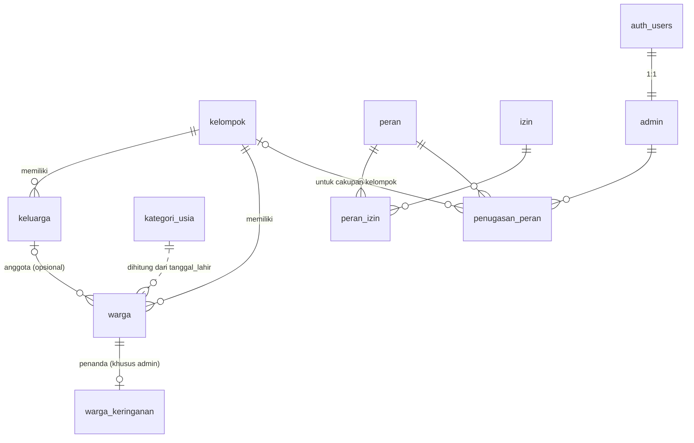

# Usulan Skema Fase 1: Database Warga & Hak Akses

> **Status: USULAN untuk direview.** Dokumen ini bukan migrasi. Belum ada SQL
> yang dijalankan ke Supabase. SQL di bawah hanya teks dan baru boleh dijadikan
> file migrasi lalu dijalankan setelah pemilik repo menyetujui ("OK, jalankan").

## 1. Tujuan

- Menyimpan profil **semua warga** (tanpa akun) per kelompok dan keluarga.
- Menyimpan **peran dan hak akses sebagai data** (tabel), bukan hardcode, supaya
  detail hak akses bisa diubah tanpa mengubah kode.
- Menegakkan pembatasan di **database lewat RLS**:
  - admin desa melihat semua data;
  - admin kelompok hanya melihat kelompoknya;
  - admin generus melihat warga usia generus di semua kelompok.
- **Tidak ada NIK atau data sensitif lain.**
- Tidak menghalangi Fase 2 (absensi QR, akun generus, jalur keringanan).

## 2. Diagram relasi



## 3. Tabel

| Tabel | Isi | Catatan |
| ----- | --- | ------- |
| `kelompok` | 4 kelompok desa (`nomor`, `nama`, `aktif`) | Nama resmi kelompok menyusul; seed memakai "Kelompok 1..4". |
| `keluarga` | Unit keluarga (`nama`, `kelompok_id`) | Satu keluarga berada di satu kelompok. |
| `warga` | `nama_lengkap`, `nama_panggilan`, `tanggal_lahir`, `jenis_kelamin` (`L`/`P`), `kelompok_id`, `keluarga_id`, `aktif` | `tanggal_lahir` boleh kosong (data awal mungkin belum lengkap). FK komposit menjamin keluarga warga ada di kelompok yang sama. |
| `warga_keringanan` | Penanda jalur keringanan (`jenis = 'tanpa_hp'`, `aktif`) | **Tabel terpisah**, lihat §4.2. |
| `kategori_usia` | `kode`, `nama`, `usia_min`, `usia_max`, `termasuk_generus`, `urutan` | Batas usia sebagai data. Rentang tidak boleh tumpang tindih (exclusion constraint). **Belum diisi**: menunggu pengurus. |
| `peran` | `admin_desa`, `admin_kelompok`, `admin_generus` + `cakupan` (`desa`/`kelompok`/`generus`) | Peran baru cukup ditambah sebagai baris. |
| `izin` | Daftar kemampuan (`warga.lihat`, `warga.ubah`, `keringanan.lihat`, ...) | |
| `peran_izin` | Peran → izin | Pemetaan default masih DRAF (§5). |
| `admin` | Profil admin, 1:1 dengan `auth.users` | Akun generus **tidak** di sini (Fase 2). |
| `penugasan_peran` | Admin → peran (+ `kelompok_id` untuk cakupan kelompok) | Satu admin bisa punya beberapa penugasan. Trigger memvalidasi `kelompok_id` sesuai cakupan. |
| view `warga_dengan_kategori` | `warga` + kategori usia hasil hitung | `security_invoker`, tetap tunduk pada RLS `warga`. |

## 4. Keputusan desain

### 4.1 Kategori usia dihitung, bukan disimpan

Kategori usia berubah sendiri seiring waktu (anak SD menjadi SMP). Kalau
disimpan di kolom, nilainya akan basi dan perlu job berkala. Karena itu
kategori **dihitung dari `tanggal_lahir`** terhadap tabel `kategori_usia`
(fungsi `private.kategori_usia_id`) dan ditampilkan lewat view
`warga_dengan_kategori`. Kalau batas usia diubah pengurus, cukup ubah datanya;
semua warga langsung ikut.

Konsekuensinya, warga tanpa `tanggal_lahir` tidak punya kategori, sehingga
tidak terlihat oleh admin generus (admin desa/kelompok tetap melihatnya).

### 4.2 Penanda keringanan di tabel terpisah

RLS Postgres bekerja **per baris, bukan per kolom**. Kalau `status_keringanan`
menjadi kolom di `warga`, siapa pun yang nanti boleh membaca baris warga
(misalnya generus yang membuka profilnya sendiri di Fase 2) juga akan
melihat penanda itu. Dengan tabel `warga_keringanan` dan izin
`keringanan.lihat`, penanda ini **hanya terlihat oleh admin**. Tidak ada kolom
alasan bebas (free text) supaya tidak menjadi tempat data sensitif.

### 4.3 Hak akses sebagai data

Semua policy memanggil satu fungsi: `private.boleh(izin, kelompok_id, tanggal_lahir)`.
Fungsi ini mengecek apakah pengguna yang sedang login punya penugasan peran
yang (a) memiliki izin tersebut dan (b) cakupannya mencakup baris itu:

| Cakupan peran | Baris yang lolos |
| ------------- | ---------------- |
| `desa` | semua |
| `kelompok` | `kelompok_id` = kelompok penugasan |
| `generus` | warga yang kategori usianya `termasuk_generus = true` (lintas kelompok) |

Izin global (`akses.kelola`, `kelompok.kelola`, `pengaturan.kelola`)
dipanggil dengan `kelompok_id = null`, sehingga hanya cakupan desa yang lolos.
Mengubah hak akses cukup dengan menambah/menghapus baris di `peran_izin`.
Policy dan kode tidak perlu diubah.

Fungsi helper ada di skema `private` (tidak terekspos lewat Data API/RPC),
memakai `security definer` + `search_path = ''`, dan `auth.uid()` dibungkus
`(select ...)` supaya dievaluasi sekali per query.

### 4.4 Lain-lain

- **Hapus**: default memakai `aktif = false` (soft delete). Hapus permanen
  dipisah ke izin `warga.hapus` (default hanya admin desa).
- **Anon** dicabut seluruh aksesnya ke tabel ini.
- **Admin pertama** (admin desa) harus dibuat manual lewat SQL oleh pemilik
  project, karena belum ada siapa pun yang memegang `akses.kelola`. Langkah ini
  juga menunggu "OK, jalankan".
- **Persiapan Fase 2** (tidak dibuat sekarang): `akun_generus (warga_id, user_id)`
  untuk login username + PIN, `kartu_qr (warga_id, kode)` untuk jalur 1, dan
  tabel `absensi`. Semuanya cukup merujuk `warga.id`, jadi skema ini tidak
  menghalangi.

## 5. Pemetaan izin default (DRAF)

| Izin | Admin desa | Admin kelompok | Admin generus |
| ---- | :-: | :-: | :-: |
| `kelompok.kelola` | ✅ | | |
| `pengaturan.kelola` (kategori usia) | ✅ | | |
| `akses.kelola` (admin & peran) | ✅ | | |
| `keluarga.lihat` / `keluarga.kelola` | ✅ | ✅ (kelompoknya) | |
| `warga.lihat` | ✅ | ✅ (kelompoknya) | ✅ (usia generus) |
| `warga.tambah` | ✅ | ✅ (kelompoknya) | |
| `warga.ubah` | ✅ | ✅ (kelompoknya) | ✅ (usia generus) |
| `warga.hapus` (permanen) | ✅ | | |
| `keringanan.lihat` / `keringanan.kelola` | ✅ | ✅ (kelompoknya) | ✅ (usia generus) |

Semua baris tabel ini bisa diubah pengurus tanpa migrasi baru.

## 6. Draf SQL migrasi

Calon nama file (belum dibuat):
`supabase/migrations/<timestamp>_fase1_warga_dan_hak_akses.sql`

```sql
-- =====================================================================
-- DRAF migrasi Fase 1: kelompok, keluarga, warga, peran sebagai data, RLS
-- STATUS: USULAN. JANGAN DIJALANKAN sebelum disetujui ("OK, jalankan").
-- =====================================================================

-- ---------------------------------------------------------------------
-- 0. Skema privat untuk fungsi helper (tidak terekspos lewat Data API)
-- ---------------------------------------------------------------------
create schema if not exists private;
revoke all on schema private from public;
grant usage on schema private to authenticated;

create or replace function private.set_updated_at()
returns trigger
language plpgsql
set search_path = ''
as $$
begin
  new.updated_at = now();
  return new;
end;
$$;

-- ---------------------------------------------------------------------
-- 1. Tipe enum
-- ---------------------------------------------------------------------
create type public.jenis_kelamin as enum ('L', 'P');
create type public.cakupan_peran as enum ('desa', 'kelompok', 'generus');

-- ---------------------------------------------------------------------
-- 2. Tabel master
-- ---------------------------------------------------------------------
create table public.kelompok (
  id          uuid primary key default gen_random_uuid(),
  nomor       smallint not null unique check (nomor > 0),
  nama        text not null check (length(trim(nama)) > 0),
  aktif       boolean not null default true,
  created_at  timestamptz not null default now(),
  updated_at  timestamptz not null default now()
);

-- Kategori usia sebagai DATA: batas umur diisi setelah diputuskan pengurus.
create table public.kategori_usia (
  id                uuid primary key default gen_random_uuid(),
  kode              text not null unique,
  nama              text not null,
  usia_min          smallint not null check (usia_min >= 0),
  usia_max          smallint check (usia_max is null or usia_max >= usia_min),
  termasuk_generus  boolean not null default false,
  urutan            smallint not null,
  created_at        timestamptz not null default now(),
  updated_at        timestamptz not null default now(),
  -- Rentang usia tidak boleh tumpang tindih.
  constraint kategori_usia_tidak_tumpang_tindih exclude using gist (
    int4range(usia_min, coalesce(usia_max, 200), '[]') with &&
  )
);

-- ---------------------------------------------------------------------
-- 3. Keluarga & warga
-- ---------------------------------------------------------------------
create table public.keluarga (
  id           uuid primary key default gen_random_uuid(),
  kelompok_id  uuid not null references public.kelompok (id) on delete restrict,
  nama         text not null check (length(trim(nama)) > 0),
  created_at   timestamptz not null default now(),
  updated_at   timestamptz not null default now(),
  created_by   uuid default auth.uid() references auth.users (id) on delete set null,
  -- Target FK komposit dari warga: menjamin keluarga & warga satu kelompok.
  unique (id, kelompok_id)
);

create table public.warga (
  id              uuid primary key default gen_random_uuid(),
  kelompok_id     uuid not null references public.kelompok (id) on delete restrict,
  keluarga_id     uuid,
  nama_lengkap    text not null check (length(trim(nama_lengkap)) > 0),
  nama_panggilan  text,
  tanggal_lahir   date check (tanggal_lahir > date '1900-01-01'),
  jenis_kelamin   public.jenis_kelamin not null,
  aktif           boolean not null default true,
  created_at      timestamptz not null default now(),
  updated_at      timestamptz not null default now(),
  created_by      uuid default auth.uid() references auth.users (id) on delete set null,
  constraint warga_keluarga_satu_kelompok
    foreign key (keluarga_id, kelompok_id)
    references public.keluarga (id, kelompok_id)
    on delete set null (keluarga_id)
);

-- Status keringanan di tabel terpisah: RLS bekerja per baris, bukan per
-- kolom. Dengan tabel sendiri, penanda ini tetap tersembunyi walaupun nanti
-- generus boleh membaca profilnya sendiri.
create table public.warga_keringanan (
  warga_id    uuid primary key references public.warga (id) on delete cascade,
  jenis       text not null default 'tanpa_hp' check (jenis in ('tanpa_hp')),
  aktif       boolean not null default true,
  created_at  timestamptz not null default now(),
  updated_at  timestamptz not null default now(),
  created_by  uuid default auth.uid() references auth.users (id) on delete set null
);

-- ---------------------------------------------------------------------
-- 4. Peran & hak akses sebagai data
-- ---------------------------------------------------------------------
create table public.peran (
  id          uuid primary key default gen_random_uuid(),
  kode        text not null unique,
  nama        text not null,
  cakupan     public.cakupan_peran not null,
  deskripsi   text,
  created_at  timestamptz not null default now(),
  updated_at  timestamptz not null default now()
);

create table public.izin (
  kode       text primary key,
  deskripsi  text not null
);

create table public.peran_izin (
  peran_id   uuid not null references public.peran (id) on delete cascade,
  izin_kode  text not null references public.izin (kode) on update cascade on delete cascade,
  primary key (peran_id, izin_kode)
);

-- Profil admin (1:1 dengan auth.users). Akun generus TIDAK di sini (Fase 2).
create table public.admin (
  user_id     uuid primary key references auth.users (id) on delete cascade,
  nama        text not null check (length(trim(nama)) > 0),
  aktif       boolean not null default true,
  created_at  timestamptz not null default now(),
  updated_at  timestamptz not null default now()
);

create table public.penugasan_peran (
  id           uuid primary key default gen_random_uuid(),
  user_id      uuid not null references public.admin (user_id) on delete cascade,
  peran_id     uuid not null references public.peran (id) on delete restrict,
  kelompok_id  uuid references public.kelompok (id) on delete cascade,
  created_at   timestamptz not null default now(),
  updated_at   timestamptz not null default now(),
  created_by   uuid default auth.uid() references auth.users (id) on delete set null,
  unique nulls not distinct (user_id, peran_id, kelompok_id)
);

-- Peran ber-cakupan 'kelompok' wajib punya kelompok_id; cakupan lain wajib null.
create or replace function private.cek_penugasan_peran()
returns trigger
language plpgsql
set search_path = ''
as $$
declare
  v_cakupan public.cakupan_peran;
begin
  select cakupan into v_cakupan from public.peran where id = new.peran_id;
  if v_cakupan = 'kelompok' and new.kelompok_id is null then
    raise exception 'Peran ber-cakupan kelompok wajib memiliki kelompok_id';
  elsif v_cakupan <> 'kelompok' and new.kelompok_id is not null then
    raise exception 'Peran ber-cakupan % tidak boleh memiliki kelompok_id', v_cakupan;
  end if;
  return new;
end;
$$;

create trigger penugasan_peran_cek
  before insert or update on public.penugasan_peran
  for each row execute function private.cek_penugasan_peran();

-- ---------------------------------------------------------------------
-- 5. Trigger updated_at
-- ---------------------------------------------------------------------
create trigger set_updated_at before update on public.kelompok
  for each row execute function private.set_updated_at();
create trigger set_updated_at before update on public.kategori_usia
  for each row execute function private.set_updated_at();
create trigger set_updated_at before update on public.keluarga
  for each row execute function private.set_updated_at();
create trigger set_updated_at before update on public.warga
  for each row execute function private.set_updated_at();
create trigger set_updated_at before update on public.warga_keringanan
  for each row execute function private.set_updated_at();
create trigger set_updated_at before update on public.peran
  for each row execute function private.set_updated_at();
create trigger set_updated_at before update on public.admin
  for each row execute function private.set_updated_at();
create trigger set_updated_at before update on public.penugasan_peran
  for each row execute function private.set_updated_at();

-- ---------------------------------------------------------------------
-- 6. Index (FK & kolom yang dipakai RLS)
-- ---------------------------------------------------------------------
create index keluarga_kelompok_id_idx       on public.keluarga (kelompok_id);
create index warga_kelompok_id_idx          on public.warga (kelompok_id);
create index warga_keluarga_id_idx          on public.warga (keluarga_id, kelompok_id);
create index warga_tanggal_lahir_idx        on public.warga (tanggal_lahir);
create index peran_izin_izin_kode_idx       on public.peran_izin (izin_kode);
create index penugasan_peran_user_id_idx    on public.penugasan_peran (user_id);
create index penugasan_peran_peran_id_idx   on public.penugasan_peran (peran_id);
create index penugasan_peran_kelompok_idx   on public.penugasan_peran (kelompok_id);

-- ---------------------------------------------------------------------
-- 7. Fungsi helper RLS
-- ---------------------------------------------------------------------
-- Kategori usia dari tanggal lahir (dihitung, bukan disimpan).
create or replace function private.kategori_usia_id(p_tanggal_lahir date)
returns uuid
language sql
stable
security definer
set search_path = ''
as $$
  select k.id
  from public.kategori_usia k
  where p_tanggal_lahir is not null
    and extract(year from age(current_date, p_tanggal_lahir))::int
        between k.usia_min and coalesce(k.usia_max, 200)
  limit 1;
$$;

create or replace function private.termasuk_generus(p_tanggal_lahir date)
returns boolean
language sql
stable
security definer
set search_path = ''
as $$
  select coalesce(
    (select k.termasuk_generus
     from public.kategori_usia k
     where k.id = private.kategori_usia_id(p_tanggal_lahir)),
    false
  );
$$;

-- Inti hak akses: apakah pengguna saat ini punya izin p_izin untuk data di
-- kelompok p_kelompok_id (dan, untuk cakupan generus, warga dengan tanggal
-- lahir p_tanggal_lahir)?
--   desa     → semua data
--   kelompok → hanya kelompok yang ditugaskan
--   generus  → hanya warga berusia generus (lintas kelompok)
-- Izin global (mis. akses.kelola) dipanggil dengan p_kelompok_id = null,
-- sehingga hanya cakupan desa yang lolos.
create or replace function private.boleh(
  p_izin text,
  p_kelompok_id uuid,
  p_tanggal_lahir date default null
)
returns boolean
language sql
stable
security definer
set search_path = ''
as $$
  select exists (
    select 1
    from public.penugasan_peran pp
    join public.admin a       on a.user_id = pp.user_id and a.aktif
    join public.peran p       on p.id = pp.peran_id
    join public.peran_izin pi on pi.peran_id = p.id and pi.izin_kode = p_izin
    where pp.user_id = (select auth.uid())
      and (
        p.cakupan = 'desa'
        or (p.cakupan = 'kelompok' and pp.kelompok_id = p_kelompok_id)
        or (p.cakupan = 'generus' and private.termasuk_generus(p_tanggal_lahir))
      )
  );
$$;

-- Versi untuk tabel yang hanya punya warga_id.
create or replace function private.boleh_warga(p_izin text, p_warga_id uuid)
returns boolean
language sql
stable
security definer
set search_path = ''
as $$
  select exists (
    select 1 from public.warga w
    where w.id = p_warga_id
      and private.boleh(p_izin, w.kelompok_id, w.tanggal_lahir)
  );
$$;

revoke all on all functions in schema private from public;
grant execute on function
  private.kategori_usia_id(date),
  private.termasuk_generus(date),
  private.boleh(text, uuid, date),
  private.boleh_warga(text, uuid)
to authenticated;

-- ---------------------------------------------------------------------
-- 8. View warga + kategori usia (security_invoker → tetap tunduk RLS warga)
-- ---------------------------------------------------------------------
create view public.warga_dengan_kategori
with (security_invoker = true) as
select
  w.*,
  k.id   as kategori_usia_id,
  k.kode as kategori_usia_kode,
  k.nama as kategori_usia_nama
from public.warga w
left join public.kategori_usia k on k.id = private.kategori_usia_id(w.tanggal_lahir);

-- ---------------------------------------------------------------------
-- 9. Row Level Security
-- ---------------------------------------------------------------------
alter table public.kelompok          enable row level security;
alter table public.kategori_usia     enable row level security;
alter table public.keluarga          enable row level security;
alter table public.warga             enable row level security;
alter table public.warga_keringanan  enable row level security;
alter table public.peran             enable row level security;
alter table public.izin              enable row level security;
alter table public.peran_izin        enable row level security;
alter table public.admin             enable row level security;
alter table public.penugasan_peran   enable row level security;

-- Pengunjung anonim tidak boleh menyentuh apa pun.
revoke all on
  public.kelompok, public.kategori_usia, public.keluarga, public.warga,
  public.warga_keringanan, public.peran, public.izin, public.peran_izin,
  public.admin, public.penugasan_peran, public.warga_dengan_kategori
from anon;

-- kelompok: daftar nama boleh dibaca semua pengguna login; kelola = desa.
create policy kelompok_select on public.kelompok
  for select to authenticated using (true);
create policy kelompok_insert on public.kelompok
  for insert to authenticated with check (private.boleh('kelompok.kelola', null));
create policy kelompok_update on public.kelompok
  for update to authenticated
  using (private.boleh('kelompok.kelola', null))
  with check (private.boleh('kelompok.kelola', null));
create policy kelompok_delete on public.kelompok
  for delete to authenticated using (private.boleh('kelompok.kelola', null));

-- kategori_usia: dibaca semua pengguna login; kelola lewat izin pengaturan.
create policy kategori_usia_select on public.kategori_usia
  for select to authenticated using (true);
create policy kategori_usia_insert on public.kategori_usia
  for insert to authenticated with check (private.boleh('pengaturan.kelola', null));
create policy kategori_usia_update on public.kategori_usia
  for update to authenticated
  using (private.boleh('pengaturan.kelola', null))
  with check (private.boleh('pengaturan.kelola', null));
create policy kategori_usia_delete on public.kategori_usia
  for delete to authenticated using (private.boleh('pengaturan.kelola', null));

-- keluarga: per kelompok.
create policy keluarga_select on public.keluarga
  for select to authenticated using (private.boleh('keluarga.lihat', kelompok_id));
create policy keluarga_insert on public.keluarga
  for insert to authenticated with check (private.boleh('keluarga.kelola', kelompok_id));
create policy keluarga_update on public.keluarga
  for update to authenticated
  using (private.boleh('keluarga.kelola', kelompok_id))
  with check (private.boleh('keluarga.kelola', kelompok_id));
create policy keluarga_delete on public.keluarga
  for delete to authenticated using (private.boleh('keluarga.kelola', kelompok_id));

-- warga: per kelompok (+ cakupan generus berdasarkan usia).
create policy warga_select on public.warga
  for select to authenticated
  using (private.boleh('warga.lihat', kelompok_id, tanggal_lahir));
create policy warga_insert on public.warga
  for insert to authenticated
  with check (private.boleh('warga.tambah', kelompok_id, tanggal_lahir));
create policy warga_update on public.warga
  for update to authenticated
  using (private.boleh('warga.ubah', kelompok_id, tanggal_lahir))
  with check (private.boleh('warga.ubah', kelompok_id, tanggal_lahir));
create policy warga_delete on public.warga
  for delete to authenticated
  using (private.boleh('warga.hapus', kelompok_id, tanggal_lahir));

-- warga_keringanan: hanya admin dengan izin keringanan.*.
create policy warga_keringanan_select on public.warga_keringanan
  for select to authenticated using (private.boleh_warga('keringanan.lihat', warga_id));
create policy warga_keringanan_insert on public.warga_keringanan
  for insert to authenticated with check (private.boleh_warga('keringanan.kelola', warga_id));
create policy warga_keringanan_update on public.warga_keringanan
  for update to authenticated
  using (private.boleh_warga('keringanan.kelola', warga_id))
  with check (private.boleh_warga('keringanan.kelola', warga_id));
create policy warga_keringanan_delete on public.warga_keringanan
  for delete to authenticated using (private.boleh_warga('keringanan.kelola', warga_id));

-- peran / izin / peran_izin: dibaca semua pengguna login (untuk UI);
-- diubah hanya pemegang akses.kelola.
create policy peran_select on public.peran
  for select to authenticated using (true);
create policy peran_kelola on public.peran
  for all to authenticated
  using (private.boleh('akses.kelola', null))
  with check (private.boleh('akses.kelola', null));

create policy izin_select on public.izin
  for select to authenticated using (true);
create policy izin_kelola on public.izin
  for all to authenticated
  using (private.boleh('akses.kelola', null))
  with check (private.boleh('akses.kelola', null));

create policy peran_izin_select on public.peran_izin
  for select to authenticated using (true);
create policy peran_izin_kelola on public.peran_izin
  for all to authenticated
  using (private.boleh('akses.kelola', null))
  with check (private.boleh('akses.kelola', null));

-- admin & penugasan_peran: lihat milik sendiri; kelola = akses.kelola.
create policy admin_select on public.admin
  for select to authenticated
  using (user_id = (select auth.uid()) or private.boleh('akses.kelola', null));
create policy admin_insert on public.admin
  for insert to authenticated with check (private.boleh('akses.kelola', null));
create policy admin_update on public.admin
  for update to authenticated
  using (private.boleh('akses.kelola', null))
  with check (private.boleh('akses.kelola', null));
create policy admin_delete on public.admin
  for delete to authenticated using (private.boleh('akses.kelola', null));

create policy penugasan_peran_select on public.penugasan_peran
  for select to authenticated
  using (user_id = (select auth.uid()) or private.boleh('akses.kelola', null));
create policy penugasan_peran_insert on public.penugasan_peran
  for insert to authenticated with check (private.boleh('akses.kelola', null));
create policy penugasan_peran_update on public.penugasan_peran
  for update to authenticated
  using (private.boleh('akses.kelola', null))
  with check (private.boleh('akses.kelola', null));
create policy penugasan_peran_delete on public.penugasan_peran
  for delete to authenticated using (private.boleh('akses.kelola', null));

-- ---------------------------------------------------------------------
-- 10. Data awal (seed) — nilai DRAF, menunggu keputusan pengurus
-- ---------------------------------------------------------------------
insert into public.kelompok (nomor, nama) values
  (1, 'Kelompok 1'),
  (2, 'Kelompok 2'),
  (3, 'Kelompok 3'),
  (4, 'Kelompok 4');

insert into public.peran (kode, nama, cakupan, deskripsi) values
  ('admin_desa',     'Admin Desa',     'desa',     'Mengelola seluruh desa'),
  ('admin_kelompok', 'Admin Kelompok', 'kelompok', 'Mengelola satu kelompok'),
  ('admin_generus',  'Admin Generus',  'generus',  'Mengelola generus (SMP s.d. pra-nikah) lintas kelompok');

insert into public.izin (kode, deskripsi) values
  ('kelompok.kelola',   'Menambah/mengubah/menghapus kelompok'),
  ('pengaturan.kelola', 'Mengubah pengaturan desa (mis. kategori usia)'),
  ('akses.kelola',      'Mengelola admin, peran, dan izin'),
  ('keluarga.lihat',    'Melihat data keluarga'),
  ('keluarga.kelola',   'Menambah/mengubah/menghapus keluarga'),
  ('warga.lihat',       'Melihat profil warga'),
  ('warga.tambah',      'Menambah warga'),
  ('warga.ubah',        'Mengubah profil warga'),
  ('warga.hapus',       'Menghapus warga secara permanen'),
  ('keringanan.lihat',  'Melihat penanda keringanan'),
  ('keringanan.kelola', 'Memberi/mencabut penanda keringanan');

-- Pemetaan default (DRAF — detail hak akses menunggu pengurus).
insert into public.peran_izin (peran_id, izin_kode)
select p.id, i.kode
from public.peran p
join public.izin i on
  (p.kode = 'admin_desa')
  or (p.kode = 'admin_kelompok' and i.kode in (
        'keluarga.lihat', 'keluarga.kelola',
        'warga.lihat', 'warga.tambah', 'warga.ubah',
        'keringanan.lihat', 'keringanan.kelola'))
  or (p.kode = 'admin_generus' and i.kode in (
        'warga.lihat', 'warga.ubah',
        'keringanan.lihat', 'keringanan.kelola'));

-- Kategori usia SENGAJA belum diisi. Contoh bentuknya (BUKAN keputusan):
-- insert into public.kategori_usia (kode, nama, usia_min, usia_max, termasuk_generus, urutan) values
--   ('caberawit', 'Caberawit', 0, 11, false, 1),
--   ('generus',   'Generus',  12, 25, true,  2),
--   ('dewasa',    'Dewasa',   26, null, false, 3);
```

### 6.1 Sudah diuji secara lokal (bukan di Supabase)

Draf SQL di atas sudah dijalankan di **PostgreSQL 16 lokal sekali pakai**
dengan stub minimal `auth.users`/`auth.uid()` dan peran `anon`/`authenticated`.
Supabase sama sekali tidak disentuh. Hasilnya:

| Skenario | Hasil |
| -------- | ----- |
| Migrasi berjalan dari nol tanpa error | ✅ |
| Admin desa melihat 4/4 warga dan penanda keringanan | ✅ |
| Admin kelompok 1 hanya melihat 2 warga Kelompok 1 | ✅ |
| Admin kelompok 1 menambah warga ke Kelompok 2 | ✅ ditolak RLS |
| Admin kelompok 1 memindahkan warga ke Kelompok 2 | ✅ ditolak RLS |
| Admin kelompok 1 memberi dirinya peran admin desa | ✅ ditolak RLS |
| Admin generus hanya melihat warga usia generus di Kelompok 1 & 2 | ✅ |
| Admin generus mengubah tanggal lahir sehingga keluar dari cakupannya | ✅ ditolak RLS |
| Admin tanpa peran: 0 warga, tetap bisa membaca daftar kelompok | ✅ |
| `anon` membaca `warga` / memanggil fungsi `private` | ✅ permission denied |
| Penugasan `admin_kelompok` tanpa `kelompok_id` | ✅ ditolak trigger |

Supabase memakai PostgreSQL 17. Fitur yang dipakai (`on delete set null (kolom)`,
`unique nulls not distinct`) tersedia sejak PG 15.

## 7. Strategi aman menguji migrasi (Supabase Free, tanpa branching)

Usulan bertahap. **Menunggu persetujuan**; tidak ada yang dijalankan sebelum itu.

1. **Migrasi sebagai file di PR.** SQL final ditaruh di
   `supabase/migrations/` dan direview lewat PR seperti kode biasa. Tidak ada
   SQL ad-hoc ke produksi.
2. **Uji lokal dengan Supabase CLI** (`supabase start`, butuh Docker).
   Stack lokal ini identik dengan Supabase sungguhan (Auth, PostgREST, PG 17).
   Jalankan `supabase db reset` untuk menerapkan semua migrasi dari nol, lalu
   `supabase test db` untuk tes RLS berbasis pgTAP (skenario §6.1 dijadikan
   file tes di `supabase/tests/`). Tes ini juga bisa dijalankan di GitHub
   Actions supaya setiap PR migrasi teruji otomatis.
3. **(Opsional, disarankan) Project staging gratis.** Paket Free mengizinkan 2
   project aktif (cek apakah slotnya masih tersedia, karena GENSITI mungkin
   sudah memakai satu). Buat project `kawanku-staging` (region sama),
   terapkan migrasi di sana dulu, lalu uji alur login sungguhan dari preview
   Vercel. Ini perubahan setting yang harus dilakukan pemilik akun, bukan saya.
4. **Cadangan sebelum produksi.** Paket Free tidak menyediakan PITR. Sebelum
   setiap migrasi produksi yang menyentuh data, ambil dump
   (`supabase db dump --data-only` + skema). Untuk migrasi pertama ini
   database masih kosong, jadi risikonya rendah.
5. **Terapkan ke produksi** hanya setelah "OK, jalankan", dengan migrasi yang
   sama persis (byte-identical) dengan yang lolos uji di langkah 2–3, lalu cek
   `get_advisors` (security & performance) setelahnya.
6. **Migrasi selalu maju.** Perbaikan dibuat sebagai migrasi baru, bukan
   mengedit migrasi yang sudah diterapkan.

## 8. Keputusan yang dibutuhkan dari pengurus

1. **Kategori usia**: nama dan batas umur tiap kategori, serta mana yang
   termasuk "generus" (SMP sampai pra-nikah).
2. **Definisi "pra-nikah"**: kalau generus dibatasi status pernikahan (bukan
   hanya usia), perlu kolom status menikah. Kolom ini tidak dibuat sekarang
   karena bisa tergolong data pribadi.
3. **Detail hak akses**: konfirmasi atau ubah tabel §5. Contohnya: apakah admin
   generus boleh menambah warga, apakah admin kelompok boleh hapus permanen,
   dan apakah admin generus perlu melihat data keluarga.
4. **Nama resmi kelompok 1–4.**
5. **Data awal warga**: sumber, format, dan siapa yang mengimpor. Juga kolom
   apa lagi yang dibutuhkan (mis. `nama_panggilan` cukup atau tidak).
6. **Data sensitif** (NIK, alamat, no. HP, foto): belum ada di skema ini, dan
   tetap tidak ada sampai ada aturannya.
