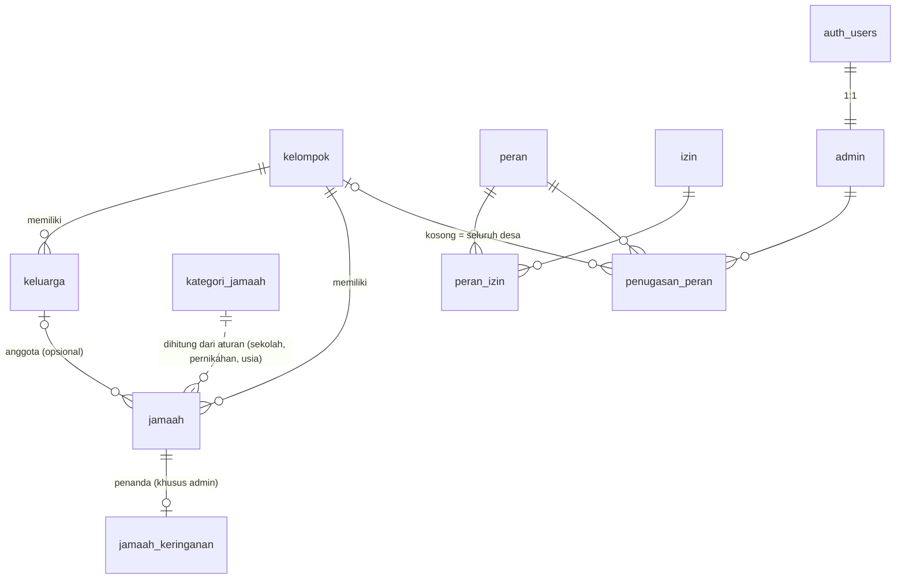

# Usulan Skema Fase 1: Database Jamaah & Hak Akses (v2)

> **Status: USULAN untuk direview.** Dokumen ini bukan migrasi. Belum ada SQL
> yang dijalankan ke Supabase dan belum ada folder `supabase/migrations`. SQL
> di bawah hanya teks. Baru boleh dijadikan file migrasi lalu dijalankan
> setelah pemilik repo menyetujui ("OK, jalankan").

### Perubahan dari v1

| Topik | v1 | v2 |
| ----- | -- | -- |
| Istilah | `warga` | **`jamaah`** (tabel, view, kolom, izin, rute `/jamaah`) |
| Cakupan peran | enum `cakupan_peran` (desa/kelompok/generus) | Dua sumbu: `peran.wilayah` (desa/kelompok/fleksibel) + `peran.hanya_generus` |
| Admin generus | Hanya tingkat desa | Tingkat desa **dan** tingkat kelompok |
| Status pernikahan | Tidak ada | Enum `status_pernikahan` (lajang/menikah/janda_duda), boleh kosong; keterangan `jenis_janda_duda` (cerai_hidup/cerai_mati) |
| Status sekolah | Tidak ada | Enum `status_sekolah` + `status_sekolah_diperbarui` (otomatis) |
| Kategori | `kategori_usia`, hanya umur, tidak boleh tumpang tindih | **`kategori_jamaah`** berbasis aturan data (usia, status sekolah, status pernikahan); tumpang tindih boleh, `urutan` terkecil menang; view `jamaah_tanpa_kategori` |
| Data lahir | `tanggal_lahir` saja | + `tahun_lahir` sebagai cadangan; satu fungsi pusat `private.usia` |
| Identitas | UUID saja | + `jamaah.kode` (KW-XXXXXX), otomatis, unik, tidak bisa diubah |
| Hubungan keluarga | Tidak ada | `jamaah.hubungan_keluarga` (Opsi A); Opsi B dijelaskan sebagai alternatif |
| Hak baca peran/izin | Semua pengguna login | Hanya admin aktif (`private.adalah_admin()`) |
| Policy | Sebagian `for all` | Satu policy per tabel per perintah |
| GRANT | Bergantung default Supabase | Eksplisit: `authenticated` saja, `anon` dicabut |
| Audit | `created_by` | + `updated_by` otomatis |
| Uji migrasi | Staging project disarankan | GitHub Actions + pgTAP sebagai gerbang utama |

## 1. Tujuan

- Menyimpan profil **semua jamaah** (tanpa akun) per kelompok dan keluarga.
- Menyimpan **peran dan hak akses sebagai data**, supaya detail hak akses bisa
  diubah pengurus tanpa mengubah kode atau migrasi.
- Menegakkan pembatasan di **database lewat RLS**:
  - admin desa melihat semua jamaah;
  - admin kelompok hanya melihat jamaah di kelompoknya;
  - admin generus melihat jamaah berkategori generus, di seluruh desa atau di
    satu kelompok (tergantung penugasannya).
- **Tidak ada NIK atau data sensitif lain.**
- Tidak menghalangi Fase 2 (absensi QR, akun generus, jalur keringanan).

## 2. Diagram relasi



## 3. Tabel

| Tabel | Isi | Catatan |
| ----- | --- | ------- |
| `kelompok` | 4 kelompok desa (`nomor`, `nama`, `aktif`) | Nama resmi menyusul; seed memakai "Kelompok 1..4". |
| `keluarga` | Unit keluarga (`nama`, `kelompok_id`) | Satu keluarga berada di satu kelompok. |
| `jamaah` | `kode`, `nama_lengkap`, `nama_panggilan`, `tanggal_lahir`, `tahun_lahir`, `jenis_kelamin` (`L`/`P`), `status_pernikahan`, `jenis_janda_duda`, `status_sekolah`, `status_sekolah_diperbarui`, `kelompok_id`, `keluarga_id`, `hubungan_keluarga`, `aktif` | Lahir dan status boleh kosong (kosong = belum diisi). `status_sekolah_diperbarui` diisi trigger. FK komposit menjamin keluarga jamaah ada di kelompok yang sama. |
| `jamaah_keringanan` | Penanda jalur keringanan (`jenis = 'tanpa_hp'`, `aktif`) | Tabel terpisah, lihat §4.8. |
| `kategori_jamaah` | `urutan`, `kode`, `nama`, `usia_min`, `usia_max`, `status_sekolah_berlaku[]`, `status_pernikahan_berlaku[]`, `termasuk_generus` | Kategori sebagai aturan data, lihat §4.4. Seed masih DRAF. |
| `peran` | `kode`, `nama`, `wilayah` (desa/kelompok/fleksibel), `hanya_generus` | Peran baru cukup ditambah sebagai baris. |
| `izin` | Daftar kemampuan (`jamaah.lihat`, `jamaah.ubah`, `keringanan.lihat`, ...) | |
| `peran_izin` | Peran → izin | Pemetaan default masih DRAF (§5). |
| `admin` | Profil admin, 1:1 dengan `auth.users` | Akun generus **tidak** di sini (Fase 2). |
| `penugasan_peran` | Admin → peran (+ `kelompok_id`; kosong = seluruh desa) | Satu admin bisa punya beberapa penugasan. Trigger memvalidasi `kelompok_id` terhadap `peran.wilayah`. |
| view `jamaah_dengan_kategori` | `jamaah` + `usia`, kategori, `termasuk_generus` | `security_invoker`, tetap tunduk pada RLS `jamaah`. Hanya bisa dibaca. |
| view `jamaah_tanpa_kategori` | Jamaah **aktif** yang tidak cocok dengan kategori mana pun | Untuk membersihkan data awal (mis. status sekolah belum diisi). `security_invoker`, tunduk RLS. |

Kolom audit: semua tabel punya `created_at`/`updated_at`. Tabel yang diisi
admin (`keluarga`, `jamaah`, `jamaah_keringanan`, `penugasan_peran`) juga punya
`created_by` (default `auth.uid()`) dan `updated_by` (diisi trigger).

## 4. Keputusan desain

### 4.1 Istilah baku: Jamaah

Sesuai keputusan Reno, semua istilah "warga" diganti "jamaah": tabel `jamaah`,
`jamaah_keringanan`, view `jamaah_dengan_kategori`, kolom `jamaah_id`, izin
`jamaah.*`, dan rute `/jamaah`.

### 4.2 Peran: dua sumbu (wilayah × sasaran)

Admin generus ada di tingkat desa dan di tingkat kelompok. Karena itu wilayah
dan sasaran dipisah:

| Sumbu | Tempat | Arti |
| ----- | ------ | ---- |
| Wilayah | `penugasan_peran.kelompok_id` | Kosong = seluruh desa; terisi = hanya kelompok itu |
| Aturan wilayah | `peran.wilayah` | `desa` → `kelompok_id` wajib kosong; `kelompok` → wajib terisi; `fleksibel` → boleh keduanya |
| Sasaran | `peran.hanya_generus` | `true` = hanya jamaah berkategori generus |

| Peran (seed) | `wilayah` | `hanya_generus` | Contoh penugasan |
| ------------ | --------- | --------------- | ---------------- |
| `admin_desa` | desa | false | Tanpa kelompok → semua jamaah di 4 kelompok |
| `admin_kelompok` | kelompok | false | Kelompok 1 → semua jamaah Kelompok 1 |
| `admin_generus` | fleksibel | true | Tanpa kelompok → generus seluruh desa; Kelompok 1 → generus Kelompok 1 |

Trigger `private.cek_penugasan_peran` menolak penugasan yang melanggar aturan
wilayah (diuji di §6.1).

### 4.3 Status pernikahan dan status sekolah

- `status_pernikahan` (enum, boleh kosong; kosong = belum diisi): `lajang`,
  `menikah`, `janda_duda`.
- `jenis_janda_duda` (enum, boleh kosong): `cerai_hidup` atau `cerai_mati`,
  sebagai keterangan bagaimana seseorang menjadi janda/duda (keputusan Reno).
  - Hanya boleh diisi bila `status_pernikahan = 'janda_duda'` (check
    `jamaah_jenis_janda_duda_sesuai`).
  - Boleh kosong bila belum diketahui.
  - Saat janda/duda menikah lagi, aplikasi harus mengosongkan kolom ini
    bersamaan dengan mengubah status. Kalau tidak, database menolak.
  - **Tidak ada** kolom alasan perceraian, tanggal, atau detail lain.
  - Kolom ini tidak memengaruhi kategori: semua janda/duda tetap
    `berkeluarga`, jadi tidak terlihat oleh admin generus.
- `status_sekolah` (enum, boleh kosong): `belum_sekolah`, `paud_tk`, `sd`,
  `smp`, `sma_smk`, `kuliah`, `bekerja`, `lainnya`.
- `status_sekolah_diperbarui` (date) diisi trigger setiap `status_sekolah`
  diisi atau berubah. Nilai yang dikirim klien diabaikan, jadi tanggalnya
  selalu bisa dipercaya untuk menandai data yang belum diperbarui di tahun
  ajaran baru.
- Keduanya enum, jadi nilai bisa ditambah nanti (`ALTER TYPE ... ADD VALUE`)
  tanpa mengubah data lama.

**Pembaruan tahunan.** Status sekolah **harus diperbarui manual setiap tahun
ajaran baru (sekitar Juli)**. `status_sekolah_diperbarui` dipakai untuk
menampilkan jamaah yang belum diperbarui sejak Juli tahun ini. Opsi kolom
`kelas` (supaya jenjang naik otomatis, mis. kelas 6 SD menjadi SMP) **ditunda**
sampai alat kenaikan jenjang dibuat. Kolom itu bisa ditambahkan belakangan
sebagai kolom nullable, tanpa merusak data.

### 4.4 Kategori jamaah: aturan data, tidak hanya umur

Tabel `kategori_jamaah` (pengganti `kategori_usia`) berisi aturan. Setiap
syarat bersifat opsional:

| Kolom syarat | Arti | Kosong berarti |
| ------------ | ---- | -------------- |
| `usia_min`, `usia_max` | Usia jamaah dalam rentang (check `usia_max >= usia_min` bila keduanya ada) | Tidak dipakai |
| `status_sekolah_berlaku status_sekolah[]` | Status sekolah jamaah ada di daftar | Semua status sekolah |
| `status_pernikahan_berlaku status_pernikahan[]` | Status pernikahan jamaah ada di daftar | Semua status pernikahan |

Aturan pencocokan (fungsi `private.kategori_jamaah_id`):

1. Kategori **cocok** bila **semua** syarat yang terisi terpenuhi.
2. Syarat yang terisi tetapi nilai jamaahnya kosong dianggap **tidak cocok**.
   Contohnya: kategori dengan daftar status sekolah tidak cocok untuk jamaah
   yang status sekolahnya belum diisi.
3. Bila lebih dari satu kategori cocok, yang dipakai adalah `urutan`
   **terkecil**. `urutan` unik, jadi hasilnya selalu pasti.
4. Bila tidak ada yang cocok, jamaah tidak punya kategori. Ia muncul di view
   `jamaah_tanpa_kategori` dan tidak terlihat oleh admin generus.

Exclusion constraint lama (larangan tumpang tindih) dihapus. Tumpang tindih
kini disengaja dan diselesaikan oleh `urutan`. Kategori dihitung, bukan
disimpan, sehingga perubahan status atau umur langsung tercermin.

**Usia hanya dipakai untuk kondisi usia (lansia).** Caberawit sampai remaja
dewasa ditentukan oleh **status sekolah**, sama sekali tidak memakai umur.
Jadi jamaah SMP tetap pra-remaja walau tanggal lahirnya belum diketahui.

Seed sementara (**DRAF**; akan diubah lewat data tanpa migrasi):

| urutan | kode | nama tampil | usia | status sekolah | status pernikahan | generus |
| -----: | ---- | ----------- | ---- | -------------- | ----------------- | :-----: |
| 1 | `lansia` | Lansia | 60+ | semua | semua | tidak |
| 2 | `berkeluarga` | Berkeluarga | – | semua | menikah, janda_duda | tidak |
| 3 | `caberawit` | Caberawit | – | belum_sekolah, paud_tk, sd | semua | tidak |
| 4 | `pra_remaja` | Pra-Remaja | – | smp | semua | ya |
| 5 | `remaja_muda` | Remaja Muda | – | sma_smk | semua | ya |
| 6 | `remaja_dewasa` | Remaja Dewasa / Usia Mandiri / Pra-Nikah | – | kuliah, bekerja, lainnya | semua | ya |

Akibat seed ini:
- Umur 60+ selalu `lansia`, apa pun status sekolah dan pernikahannya
  (urutan 1).
- Menikah atau janda/duda di bawah 60 menjadi `berkeluarga`, walau masih
  kuliah (urutan 2 menang atas `remaja_dewasa`).
- Lajang atau status pernikahan kosong, di bawah 60, dengan status sekolah
  kuliah/bekerja/lainnya menjadi `remaja_dewasa` **tanpa batas atas umur**.
  Ini keputusan Reno: remaja dewasa tidak dibatasi umur, dan baru berganti
  kategori saat menikah atau mencapai 60 (lansia).
- Jamaah dengan status sekolah kosong, tidak menikah, dan di bawah 60 (atau
  umurnya tidak diketahui) tidak punya kategori, sehingga muncul di
  `jamaah_tanpa_kategori`.

### 4.5 Usia: tanggal lahir, cadangan tahun lahir

- `tanggal_lahir` dan `tahun_lahir` sama-sama boleh kosong.
- Check `jamaah_tahun_sesuai_tanggal`: bila keduanya terisi, tahun harus sama
  dengan tahun dari tanggal lahir.
- **Satu fungsi pusat** `private.usia(tanggal_lahir, tahun_lahir)` dipakai oleh
  kategori, view, dan RLS:
  - dari `tanggal_lahir` bila ada (usia tepat);
  - bila tidak, `tahun ini - tahun_lahir`. Ini bisa lebih tua 1 tahun dari usia
    sebenarnya sebelum hari ulang tahun.
- Dengan seed sekarang, usia hanya menentukan `lansia`. Jamaah tanpa tanggal
  dan tahun lahir tetap bisa berkategori lewat status sekolah atau status
  pernikahan.

### 4.6 Kode jamaah (`jamaah.kode`)

- Format `KW-` + 6 karakter dari alfabet tanpa karakter ambigu (tanpa `0 O 1 I
  L`), 31 karakter, sekitar 887 juta kombinasi. Contoh: `KW-7HQ2MX`.
- Acak (dari `gen_random_uuid()`, dengan rejection sampling supaya merata),
  tidak mengandung data pribadi, dan tidak berurutan.
- **Selalu dibuat server** saat insert; nilai dari klien diabaikan.
- **Unik lintas kelompok**: `private.buat_kode_jamaah()` berjalan sebagai
  `security definer`, jadi pengecekan tabrakan melihat semua baris, termasuk
  kelompok lain yang tidak terlihat oleh RLS pemanggil. Fungsi mencoba ulang
  sampai 20 kali. Constraint `unique` tetap menjadi pengaman terakhir untuk
  insert bersamaan.
- **Tidak bisa diubah**: trigger menolak update kolom `kode`.
- Kegunaan: menautkan data keluarga dan mencocokkan baris saat impor/ekspor
  spreadsheet, tanpa memakai nama atau tanggal lahir sebagai kunci.
- **Bukan token QR.** Token kartu QR (Fase 2) adalah kode acak terpisah di
  tabel `kartu_qr`, supaya kartu yang hilang bisa dicabut tanpa mengubah
  identitas jamaah.

### 4.7 Hubungan keluarga

**Opsi A, dipakai di draf ini.** `keluarga` tetap menjadi kelompok keluarga,
dan setiap jamaah punya `hubungan_keluarga` (nullable): `kepala_keluarga`,
`pasangan`, `anak`, `orang_tua`, `lainnya`. Hubungan dibaca relatif terhadap
kepala keluarga.

**Opsi B, alternatif untuk dinilai (TIDAK diimplementasikan).** Kolom self-FK
`ayah_id`, `ibu_id`, `pasangan_id` di `jamaah` yang menunjuk ke jamaah lain.

| | Opsi A (`hubungan_keluarga`) | Opsi B (`ayah_id`/`ibu_id`/`pasangan_id`) |
| - | --- | --- |
| Input admin | Mudah: satu pilihan per orang | Lebih berat: harus memilih orang lain untuk setiap relasi |
| Deteksi otomatis | Terbatas pada satu keluarga | Kuat: saudara kandung, kakek-nenek, anak yang sudah berkeluarga sendiri |
| Data tidak lengkap | Aman (cukup kosong) | Banyak orang tua wafat atau di luar desa, sehingga sering kosong atau perlu baris "bayangan" |
| Konsistensi | Sederhana | Pasangan harus simetris (butuh trigger) dan mencegah siklus |
| Pindah keluarga (menikah) | Pindah `keluarga_id` | Relasi tetap; keluarga bisa diturunkan otomatis |
| Dampak RLS | Tidak ada; semua dalam satu kelompok | Relasi lintas kelompok umum (menikah antarkelompok). Admin kelompok/generus akan melihat UUID orang tua/pasangan yang barisnya tidak boleh ia baca (join kosong). Cek FK berjalan tanpa RLS, jadi FK bisa dipakai menebak keberadaan sebuah UUID (risiko kecil karena UUID acak). |

Rekomendasi: mulai dengan **Opsi A**. Opsi B bisa ditambahkan belakangan
sebagai kolom nullable baru (migrasi aditif, tidak merusak data). Jadi
keputusan ini bisa ditunda sampai kebutuhan silsilah jelas.

### 4.8 Penanda keringanan di tabel terpisah

RLS bekerja per baris, bukan per kolom. Kalau penanda keringanan menjadi kolom
di `jamaah`, siapa pun yang boleh membaca baris jamaah akan ikut melihatnya.
Contohnya generus yang membuka profilnya sendiri di Fase 2.

Karena itu penanda disimpan di tabel `jamaah_keringanan` dengan izin
`keringanan.lihat`, sehingga hanya terlihat oleh admin. Tidak ada kolom alasan
bebas (free text), supaya tabel ini tidak menjadi tempat data sensitif.

### 4.9 Hak akses sebagai data: `private.boleh`

Semua policy jamaah memanggil
`private.boleh(izin, kelompok_id, tanggal_lahir, tahun_lahir, status_pernikahan, status_sekolah)`. Fungsi
ini lolos bila pengguna punya penugasan yang memenuhi ketiga syarat berikut:

1. **Admin aktif dan izin:** baris `admin`-nya aktif, dan perannya memiliki
   izin tersebut.
2. **Wilayah:**
   - penugasan **tanpa** `kelompok_id` lolos untuk semua kelompok;
   - penugasan **dengan** `kelompok_id` hanya lolos untuk kelompok itu;
   - izin global (`kelompok_id` null, mis. `akses.kelola`) hanya lolos untuk
     penugasan tanpa `kelompok_id`.
3. **Sasaran:** bila perannya `hanya_generus`, hanya lolos untuk jamaah yang
   kategorinya `termasuk_generus`. Izin global otomatis tidak lolos untuk peran
   ini.

Helper lain:
- `private.boleh_jamaah(izin, jamaah_id)`: untuk tabel yang hanya punya
  `jamaah_id`.
- `private.adalah_admin()`: punya baris `admin` aktif **dan** minimal satu
  penugasan.
- `private.usia`, `private.kategori_jamaah_id`, `private.termasuk_generus`.

Semua helper ada di skema `private` (tidak terekspos lewat Data API/RPC),
memakai `security definer` + `search_path = ''`, dan `auth.uid()` dibungkus
`(select ...)` supaya dievaluasi sekali per query.

Konsekuensi yang perlu disadari: admin generus yang mengubah
`status_pernikahan` menjadi `menikah`/`janda_duda`, atau mengubah/mengosongkan
`status_sekolah` sehingga jamaah keluar dari kategori generus, akan
**ditolak** (WITH CHECK). Perubahan di dalam cakupan, misalnya `sma_smk`
menjadi `kuliah`, tetap boleh. Pencatatan pernikahan generus harus dilakukan
admin kelompok atau admin desa (lihat pertanyaan §8).

### 4.10 GRANT eksplisit dan policy per perintah

- Migrasi mencabut semua hak `anon` dan `authenticated` dari tabel dan view
  Fase 1, lalu memberi `select, insert, update, delete` ke `authenticated`
  secara eksplisit. View hanya diberi `select`. Jadi keamanan tidak bergantung
  pada default grant Supabase.
- `peran`, `izin`, dan `peran_izin` hanya bisa dibaca admin aktif. Mulai Fase
  2, akun generus juga berperan `authenticated`, dan mereka tidak perlu tahu
  struktur hak akses. `kelompok` dan `kategori_jamaah` tetap boleh dibaca semua
  pengguna login.
- Tidak ada policy `for all`: setiap tabel punya tepat satu policy per
  perintah (select/insert/update/delete). Dengan begitu tidak ada peringatan
  "multiple permissive policies" dari Supabase advisor.

### 4.11 Lain-lain

- **Hapus**: default memakai `aktif = false` (soft delete). Hapus permanen
  dipisah ke izin `jamaah.hapus` (default hanya admin desa).
- **Admin pertama** dibuat lewat SQL bootstrap (§6.2), karena belum ada siapa
  pun yang memegang `akses.kelola`.
- **Persiapan Fase 2**: lihat §9.

## 5. Pemetaan izin default (DRAF)

| Izin | Admin desa | Admin kelompok | Admin generus |
| ---- | :-: | :-: | :-: |
| `kelompok.kelola` | ✅ | | |
| `pengaturan.kelola` (kategori jamaah) | ✅ | | |
| `akses.kelola` (admin & peran) | ✅ | | |
| `keluarga.lihat` / `keluarga.kelola` | ✅ | ✅ (kelompoknya) | |
| `jamaah.lihat` | ✅ | ✅ (kelompoknya) | ✅ (generus di wilayahnya) |
| `jamaah.tambah` | ✅ | ✅ (kelompoknya) | |
| `jamaah.ubah` | ✅ | ✅ (kelompoknya) | ✅ (generus di wilayahnya) |
| `jamaah.hapus` (permanen) | ✅ | | |
| `keringanan.lihat` / `keringanan.kelola` | ✅ | ✅ (kelompoknya) | ✅ (generus di wilayahnya) |

"Wilayahnya" untuk admin generus berarti seluruh desa bila penugasannya tanpa
kelompok, atau satu kelompok bila penugasannya dengan kelompok. Semua baris
tabel ini bisa diubah pengurus tanpa migrasi baru.

## 6. Draf SQL migrasi

Calon nama file (belum dibuat):
`supabase/migrations/<timestamp>_fase1_jamaah_dan_hak_akses.sql`

```sql
-- =====================================================================
-- DRAF migrasi Fase 1 (v2): kelompok, keluarga, jamaah, peran sebagai data, RLS
-- STATUS: USULAN. JANGAN DIJALANKAN sebelum disetujui ("OK, jalankan").
-- =====================================================================

-- ---------------------------------------------------------------------
-- 0. Skema privat untuk fungsi helper (tidak terekspos lewat Data API)
-- ---------------------------------------------------------------------
create schema if not exists private;
revoke all on schema private from public;
grant usage on schema private to authenticated;

create or replace function private.set_updated_at()
returns trigger
language plpgsql
set search_path = ''
as $$
begin
  new.updated_at = now();
  return new;
end;
$$;

-- Mengisi updated_by dengan pengguna yang sedang login (null bila lewat SQL/
-- service role).
create or replace function private.set_updated_by()
returns trigger
language plpgsql
set search_path = ''
as $$
begin
  new.updated_by = auth.uid();
  return new;
end;
$$;

-- ---------------------------------------------------------------------
-- 1. Tipe enum (nilai bisa ditambah nanti dengan ALTER TYPE ... ADD VALUE)
-- ---------------------------------------------------------------------
create type public.jenis_kelamin as enum ('L', 'P');
create type public.status_pernikahan as enum ('lajang', 'menikah', 'janda_duda');
-- Keterangan janda/duda: hanya jenisnya (cerai hidup / cerai mati), tanpa
-- alasan atau detail lain.
create type public.jenis_janda_duda as enum ('cerai_hidup', 'cerai_mati');
create type public.status_sekolah as enum
  ('belum_sekolah', 'paud_tk', 'sd', 'smp', 'sma_smk', 'kuliah', 'bekerja', 'lainnya');
create type public.wilayah_peran as enum ('desa', 'kelompok', 'fleksibel');
create type public.hubungan_keluarga as enum
  ('kepala_keluarga', 'pasangan', 'anak', 'orang_tua', 'lainnya');

-- ---------------------------------------------------------------------
-- 2. Tabel master
-- ---------------------------------------------------------------------
create table public.kelompok (
  id          uuid primary key default gen_random_uuid(),
  nomor       smallint not null unique check (nomor > 0),
  nama        text not null check (length(trim(nama)) > 0),
  aktif       boolean not null default true,
  created_at  timestamptz not null default now(),
  updated_at  timestamptz not null default now()
);

-- Kategori jamaah sebagai DATA, berbasis aturan (usia, status sekolah, status
-- pernikahan). Kategori cocok bila SEMUA syarat yang terisi terpenuhi; bila
-- beberapa cocok, `urutan` terkecil menang. Lihat private.kategori_jamaah_id.
-- Syarat kosong (null atau array kosong) = tidak dipakai.
create table public.kategori_jamaah (
  id                         uuid primary key default gen_random_uuid(),
  kode                       text not null unique,
  nama                       text not null,
  usia_min                   smallint check (usia_min >= 0),
  usia_max                   smallint check (usia_max >= 0),
  status_sekolah_berlaku     public.status_sekolah[],
  status_pernikahan_berlaku  public.status_pernikahan[],
  termasuk_generus           boolean not null default false,
  urutan                     smallint not null unique,
  created_at                 timestamptz not null default now(),
  updated_at                 timestamptz not null default now(),
  constraint kategori_jamaah_rentang_usia check (
    usia_min is null or usia_max is null or usia_max >= usia_min
  )
);

-- ---------------------------------------------------------------------
-- 3. Keluarga & jamaah
-- ---------------------------------------------------------------------
create table public.keluarga (
  id           uuid primary key default gen_random_uuid(),
  kelompok_id  uuid not null references public.kelompok (id) on delete restrict,
  nama         text not null check (length(trim(nama)) > 0),
  created_at   timestamptz not null default now(),
  updated_at   timestamptz not null default now(),
  created_by   uuid default auth.uid() references auth.users (id) on delete set null,
  updated_by   uuid references auth.users (id) on delete set null,
  -- Target FK komposit dari jamaah: menjamin keluarga & jamaah satu kelompok.
  unique (id, kelompok_id)
);

create table public.jamaah (
  id                 uuid primary key default gen_random_uuid(),
  -- Kode unik per individu (KW-XXXXXX), diisi otomatis, tidak bisa diubah.
  -- BUKAN token QR (token kartu ada di tabel kartu_qr, Fase 2).
  kode               text not null unique,
  kelompok_id        uuid not null references public.kelompok (id) on delete restrict,
  keluarga_id        uuid,
  hubungan_keluarga  public.hubungan_keluarga,
  nama_lengkap       text not null check (length(trim(nama_lengkap)) > 0),
  nama_panggilan     text,
  tanggal_lahir      date check (tanggal_lahir > date '1900-01-01'),
  -- Cadangan bila tanggal lahir lengkap tidak diketahui.
  tahun_lahir        smallint check (tahun_lahir between 1900 and 2100),
  jenis_kelamin      public.jenis_kelamin not null,
  -- kosong = belum diisi
  status_pernikahan  public.status_pernikahan,
  -- Hanya untuk janda_duda; boleh kosong bila belum diketahui.
  jenis_janda_duda   public.jenis_janda_duda,
  status_sekolah     public.status_sekolah,
  -- Diisi trigger setiap status_sekolah berubah (untuk pengingat tahun ajaran).
  status_sekolah_diperbarui  date,
  aktif              boolean not null default true,
  created_at         timestamptz not null default now(),
  updated_at         timestamptz not null default now(),
  created_by         uuid default auth.uid() references auth.users (id) on delete set null,
  updated_by         uuid references auth.users (id) on delete set null,
  constraint jamaah_tahun_sesuai_tanggal check (
    tanggal_lahir is null
    or tahun_lahir is null
    or tahun_lahir = extract(year from tanggal_lahir)::int
  ),
  constraint jamaah_jenis_janda_duda_sesuai check (
    jenis_janda_duda is null or status_pernikahan = 'janda_duda'
  ),
  constraint jamaah_keluarga_satu_kelompok
    foreign key (keluarga_id, kelompok_id)
    references public.keluarga (id, kelompok_id)
    on delete set null (keluarga_id)
);

-- Status keringanan di tabel terpisah: RLS bekerja per baris, bukan per
-- kolom. Dengan tabel sendiri, penanda ini tetap tersembunyi walaupun nanti
-- generus boleh membaca profilnya sendiri (Fase 2).
create table public.jamaah_keringanan (
  jamaah_id   uuid primary key references public.jamaah (id) on delete cascade,
  jenis       text not null default 'tanpa_hp' check (jenis in ('tanpa_hp')),
  aktif       boolean not null default true,
  created_at  timestamptz not null default now(),
  updated_at  timestamptz not null default now(),
  created_by  uuid default auth.uid() references auth.users (id) on delete set null,
  updated_by  uuid references auth.users (id) on delete set null
);

-- ---------------------------------------------------------------------
-- 4. Peran & hak akses sebagai data
-- ---------------------------------------------------------------------
-- Dua sumbu terpisah:
--   wilayah        : 'desa' (kelompok_id penugasan wajib kosong),
--                    'kelompok' (wajib terisi), 'fleksibel' (boleh keduanya)
--   hanya_generus  : true = hanya jamaah berkategori generus
create table public.peran (
  id             uuid primary key default gen_random_uuid(),
  kode           text not null unique,
  nama           text not null,
  wilayah        public.wilayah_peran not null,
  hanya_generus  boolean not null default false,
  deskripsi      text,
  created_at     timestamptz not null default now(),
  updated_at     timestamptz not null default now()
);

create table public.izin (
  kode       text primary key,
  deskripsi  text not null
);

create table public.peran_izin (
  peran_id   uuid not null references public.peran (id) on delete cascade,
  izin_kode  text not null references public.izin (kode) on update cascade on delete cascade,
  primary key (peran_id, izin_kode)
);

-- Profil admin (1:1 dengan auth.users). Akun generus TIDAK di sini (Fase 2).
create table public.admin (
  user_id     uuid primary key references auth.users (id) on delete cascade,
  nama        text not null check (length(trim(nama)) > 0),
  aktif       boolean not null default true,
  created_at  timestamptz not null default now(),
  updated_at  timestamptz not null default now()
);

-- kelompok_id kosong = seluruh desa; terisi = hanya kelompok itu.
create table public.penugasan_peran (
  id           uuid primary key default gen_random_uuid(),
  user_id      uuid not null references public.admin (user_id) on delete cascade,
  peran_id     uuid not null references public.peran (id) on delete restrict,
  kelompok_id  uuid references public.kelompok (id) on delete cascade,
  created_at   timestamptz not null default now(),
  updated_at   timestamptz not null default now(),
  created_by   uuid default auth.uid() references auth.users (id) on delete set null,
  updated_by   uuid references auth.users (id) on delete set null,
  unique nulls not distinct (user_id, peran_id, kelompok_id)
);

-- Validasi wilayah peran terhadap kelompok_id penugasan.
create or replace function private.cek_penugasan_peran()
returns trigger
language plpgsql
set search_path = ''
as $$
declare
  v_wilayah public.wilayah_peran;
begin
  select wilayah into v_wilayah from public.peran where id = new.peran_id;
  if v_wilayah = 'desa' and new.kelompok_id is not null then
    raise exception 'Peran tingkat desa tidak boleh memiliki kelompok_id';
  elsif v_wilayah = 'kelompok' and new.kelompok_id is null then
    raise exception 'Peran tingkat kelompok wajib memiliki kelompok_id';
  end if;
  return new;
end;
$$;

create trigger penugasan_peran_cek
  before insert or update on public.penugasan_peran
  for each row execute function private.cek_penugasan_peran();

-- ---------------------------------------------------------------------
-- 5. Kode jamaah: otomatis, acak, unik lintas kelompok, tidak bisa diubah
-- ---------------------------------------------------------------------
-- Alfabet tanpa karakter ambigu (tanpa 0, O, 1, I, L): 31 karakter.
-- 6 karakter = 31^6 ≈ 887 juta kombinasi.
-- security definer: pengecekan tabrakan melihat SEMUA baris, termasuk
-- kelompok lain yang tidak terlihat oleh RLS pemanggil.
create or replace function private.buat_kode_jamaah()
returns text
language plpgsql
volatile
security definer
set search_path = ''
as $$
declare
  v_alfabet constant text := '23456789ABCDEFGHJKMNPQRSTUVWXYZ';
  v_kode   text;
  v_bytes  bytea;
  v_byte   int;
  v_i      int;
begin
  for v_percobaan in 1..20 loop
    v_kode := '';
    while length(v_kode) < 6 loop
      v_bytes := uuid_send(gen_random_uuid());
      for v_i in 0..15 loop
        v_byte := get_byte(v_bytes, v_i);
        -- Tolak byte >= 248 (31 × 8) agar distribusi merata.
        if v_byte < 248 and length(v_kode) < 6 then
          v_kode := v_kode || substr(v_alfabet, (v_byte % 31) + 1, 1);
        end if;
      end loop;
    end loop;
    v_kode := 'KW-' || v_kode;
    if not exists (select 1 from public.jamaah where kode = v_kode) then
      return v_kode;
    end if;
  end loop;
  raise exception 'Gagal membuat kode jamaah unik setelah 20 percobaan';
end;
$$;

create or replace function private.atur_kode_jamaah()
returns trigger
language plpgsql
security definer
set search_path = ''
as $$
begin
  if tg_op = 'INSERT' then
    -- Selalu dibuat server; nilai dari klien diabaikan.
    new.kode := private.buat_kode_jamaah();
  elsif new.kode is distinct from old.kode then
    raise exception 'Kode jamaah tidak boleh diubah';
  end if;
  return new;
end;
$$;

create trigger jamaah_kode
  before insert or update on public.jamaah
  for each row execute function private.atur_kode_jamaah();

-- status_sekolah_diperbarui: diisi tanggal hari ini saat status_sekolah diisi
-- atau berubah; selain itu dipertahankan (nilai dari klien diabaikan).
create or replace function private.atur_status_sekolah_diperbarui()
returns trigger
language plpgsql
set search_path = ''
as $$
begin
  if tg_op = 'INSERT' then
    new.status_sekolah_diperbarui :=
      case when new.status_sekolah is not null then current_date end;
  elsif new.status_sekolah is distinct from old.status_sekolah then
    new.status_sekolah_diperbarui := current_date;
  else
    new.status_sekolah_diperbarui := old.status_sekolah_diperbarui;
  end if;
  return new;
end;
$$;

create trigger jamaah_status_sekolah_diperbarui
  before insert or update on public.jamaah
  for each row execute function private.atur_status_sekolah_diperbarui();

-- ---------------------------------------------------------------------
-- 6. Trigger updated_at & updated_by
-- ---------------------------------------------------------------------
create trigger set_updated_at before update on public.kelompok
  for each row execute function private.set_updated_at();
create trigger set_updated_at before update on public.kategori_jamaah
  for each row execute function private.set_updated_at();
create trigger set_updated_at before update on public.keluarga
  for each row execute function private.set_updated_at();
create trigger set_updated_at before update on public.jamaah
  for each row execute function private.set_updated_at();
create trigger set_updated_at before update on public.jamaah_keringanan
  for each row execute function private.set_updated_at();
create trigger set_updated_at before update on public.peran
  for each row execute function private.set_updated_at();
create trigger set_updated_at before update on public.admin
  for each row execute function private.set_updated_at();
create trigger set_updated_at before update on public.penugasan_peran
  for each row execute function private.set_updated_at();

create trigger set_updated_by before insert or update on public.keluarga
  for each row execute function private.set_updated_by();
create trigger set_updated_by before insert or update on public.jamaah
  for each row execute function private.set_updated_by();
create trigger set_updated_by before insert or update on public.jamaah_keringanan
  for each row execute function private.set_updated_by();
create trigger set_updated_by before insert or update on public.penugasan_peran
  for each row execute function private.set_updated_by();

-- ---------------------------------------------------------------------
-- 7. Index (FK & kolom yang dipakai RLS)
-- ---------------------------------------------------------------------
create index keluarga_kelompok_id_idx       on public.keluarga (kelompok_id);
create index jamaah_kelompok_id_idx         on public.jamaah (kelompok_id);
create index jamaah_keluarga_id_idx         on public.jamaah (keluarga_id, kelompok_id);
create index peran_izin_izin_kode_idx       on public.peran_izin (izin_kode);
create index penugasan_peran_user_id_idx    on public.penugasan_peran (user_id);
create index penugasan_peran_peran_id_idx   on public.penugasan_peran (peran_id);
create index penugasan_peran_kelompok_idx   on public.penugasan_peran (kelompok_id);

-- ---------------------------------------------------------------------
-- 8. Fungsi pusat usia & kategori, dan helper RLS
-- ---------------------------------------------------------------------
-- SATU-SATUNYA tempat usia dihitung: dari tanggal_lahir bila ada, kalau
-- tidak dari selisih tahun (tahun ini - tahun_lahir). Null bila keduanya kosong.
create or replace function private.usia(p_tanggal_lahir date, p_tahun_lahir smallint)
returns int
language sql
stable
set search_path = ''
as $$
  select coalesce(
    extract(year from age(current_date, p_tanggal_lahir))::int,
    extract(year from current_date)::int - p_tahun_lahir
  );
$$;

-- Kategori jamaah. Cocok bila SEMUA syarat yang terisi terpenuhi:
--   usia_min/usia_max  : usia (private.usia) dalam rentang;
--   status_*_berlaku   : nilai jamaah ada di dalam array.
-- Syarat yang terisi tetapi nilai jamaahnya kosong = TIDAK cocok.
-- Bila beberapa cocok, `urutan` terkecil menang. Bila tidak ada, null.
create or replace function private.kategori_jamaah_id(
  p_tanggal_lahir date,
  p_tahun_lahir smallint,
  p_status_pernikahan public.status_pernikahan,
  p_status_sekolah public.status_sekolah
)
returns uuid
language sql
stable
security definer
set search_path = ''
as $$
  select k.id
  from public.kategori_jamaah k
  cross join lateral (select private.usia(p_tanggal_lahir, p_tahun_lahir) as usia) u
  where (k.usia_min is null or u.usia >= k.usia_min)
    and (k.usia_max is null or u.usia <= k.usia_max)
    and (coalesce(cardinality(k.status_sekolah_berlaku), 0) = 0
         or p_status_sekolah = any (k.status_sekolah_berlaku))
    and (coalesce(cardinality(k.status_pernikahan_berlaku), 0) = 0
         or p_status_pernikahan = any (k.status_pernikahan_berlaku))
  order by k.urutan
  limit 1;
$$;

create or replace function private.termasuk_generus(
  p_tanggal_lahir date,
  p_tahun_lahir smallint,
  p_status_pernikahan public.status_pernikahan,
  p_status_sekolah public.status_sekolah
)
returns boolean
language sql
stable
security definer
set search_path = ''
as $$
  select coalesce(
    (select k.termasuk_generus
     from public.kategori_jamaah k
     where k.id = private.kategori_jamaah_id(
       p_tanggal_lahir, p_tahun_lahir, p_status_pernikahan, p_status_sekolah)),
    false
  );
$$;

-- Inti hak akses. Lolos bila pengguna punya penugasan aktif yang:
--   (a) perannya memiliki izin p_izin;
--   (b) wilayahnya cocok: penugasan tanpa kelompok_id lolos untuk semua
--       kelompok; dengan kelompok_id hanya untuk kelompok itu. Izin global
--       (p_kelompok_id null) hanya lolos untuk penugasan tanpa kelompok_id;
--   (c) bila perannya hanya_generus: hanya untuk jamaah generus, dan izin
--       global otomatis tidak lolos. Sasaran generus ditentukan kategori
--       jamaah (status sekolah/pernikahan/usia), bukan umur semata.
create or replace function private.boleh(
  p_izin text,
  p_kelompok_id uuid,
  p_tanggal_lahir date default null,
  p_tahun_lahir smallint default null,
  p_status_pernikahan public.status_pernikahan default null,
  p_status_sekolah public.status_sekolah default null
)
returns boolean
language sql
stable
security definer
set search_path = ''
as $$
  select exists (
    select 1
    from public.penugasan_peran pp
    join public.admin a       on a.user_id = pp.user_id and a.aktif
    join public.peran p       on p.id = pp.peran_id
    join public.peran_izin pi on pi.peran_id = p.id and pi.izin_kode = p_izin
    where pp.user_id = (select auth.uid())
      and (pp.kelompok_id is null or pp.kelompok_id = p_kelompok_id)
      and (
        not p.hanya_generus
        or (
          p_kelompok_id is not null
          and private.termasuk_generus(
            p_tanggal_lahir, p_tahun_lahir, p_status_pernikahan, p_status_sekolah)
        )
      )
  );
$$;

-- Versi untuk tabel yang hanya punya jamaah_id.
create or replace function private.boleh_jamaah(p_izin text, p_jamaah_id uuid)
returns boolean
language sql
stable
security definer
set search_path = ''
as $$
  select exists (
    select 1 from public.jamaah j
    where j.id = p_jamaah_id
      and private.boleh(p_izin, j.kelompok_id, j.tanggal_lahir, j.tahun_lahir,
                       j.status_pernikahan, j.status_sekolah)
  );
$$;

-- Admin aktif = punya baris admin aktif DAN minimal satu penugasan peran.
-- Akun generus (Fase 2) juga berperan `authenticated`, tapi bukan admin.
create or replace function private.adalah_admin()
returns boolean
language sql
stable
security definer
set search_path = ''
as $$
  select exists (
    select 1
    from public.admin a
    join public.penugasan_peran pp on pp.user_id = a.user_id
    where a.user_id = (select auth.uid()) and a.aktif
  );
$$;

revoke all on all functions in schema private from public;
grant execute on function
  private.usia(date, smallint),
  private.kategori_jamaah_id(date, smallint, public.status_pernikahan, public.status_sekolah),
  private.termasuk_generus(date, smallint, public.status_pernikahan, public.status_sekolah),
  private.boleh(text, uuid, date, smallint, public.status_pernikahan, public.status_sekolah),
  private.boleh_jamaah(text, uuid),
  private.adalah_admin()
to authenticated;

-- ---------------------------------------------------------------------
-- 9. View jamaah + usia + kategori (security_invoker → tetap tunduk RLS jamaah)
-- ---------------------------------------------------------------------
create view public.jamaah_dengan_kategori
with (security_invoker = true) as
select
  j.*,
  private.usia(j.tanggal_lahir, j.tahun_lahir) as usia,
  k.id               as kategori_jamaah_id,
  k.kode             as kategori_jamaah_kode,
  k.nama             as kategori_jamaah_nama,
  coalesce(k.termasuk_generus, false) as termasuk_generus
from public.jamaah j
left join public.kategori_jamaah k
  on k.id = private.kategori_jamaah_id(
       j.tanggal_lahir, j.tahun_lahir, j.status_pernikahan, j.status_sekolah);

-- Untuk membersihkan data awal: jamaah aktif yang tidak cocok dengan kategori
-- mana pun (mis. status sekolah belum diisi). Tetap tunduk RLS jamaah.
create view public.jamaah_tanpa_kategori
with (security_invoker = true) as
select *
from public.jamaah_dengan_kategori
where aktif and kategori_jamaah_id is null;

-- ---------------------------------------------------------------------
-- 10. GRANT eksplisit (tidak bergantung pada default grant Supabase)
-- ---------------------------------------------------------------------
revoke all on
  public.kelompok, public.kategori_jamaah, public.keluarga, public.jamaah,
  public.jamaah_keringanan, public.peran, public.izin, public.peran_izin,
  public.admin, public.penugasan_peran, public.jamaah_dengan_kategori,
  public.jamaah_tanpa_kategori
from anon, authenticated;

grant select, insert, update, delete on
  public.kelompok, public.kategori_jamaah, public.keluarga, public.jamaah,
  public.jamaah_keringanan, public.peran, public.izin, public.peran_izin,
  public.admin, public.penugasan_peran
to authenticated;

grant select on public.jamaah_dengan_kategori, public.jamaah_tanpa_kategori to authenticated;

-- ---------------------------------------------------------------------
-- 11. Row Level Security (satu policy per tabel per perintah)
-- ---------------------------------------------------------------------
alter table public.kelompok           enable row level security;
alter table public.kategori_jamaah    enable row level security;
alter table public.keluarga           enable row level security;
alter table public.jamaah             enable row level security;
alter table public.jamaah_keringanan  enable row level security;
alter table public.peran              enable row level security;
alter table public.izin               enable row level security;
alter table public.peran_izin         enable row level security;
alter table public.admin              enable row level security;
alter table public.penugasan_peran    enable row level security;

-- kelompok: dibaca semua pengguna login; kelola = izin global.
create policy kelompok_select on public.kelompok
  for select to authenticated using (true);
create policy kelompok_insert on public.kelompok
  for insert to authenticated with check (private.boleh('kelompok.kelola', null));
create policy kelompok_update on public.kelompok
  for update to authenticated
  using (private.boleh('kelompok.kelola', null))
  with check (private.boleh('kelompok.kelola', null));
create policy kelompok_delete on public.kelompok
  for delete to authenticated using (private.boleh('kelompok.kelola', null));

-- kategori_jamaah: dibaca semua pengguna login; kelola = izin global.
create policy kategori_jamaah_select on public.kategori_jamaah
  for select to authenticated using (true);
create policy kategori_jamaah_insert on public.kategori_jamaah
  for insert to authenticated with check (private.boleh('pengaturan.kelola', null));
create policy kategori_jamaah_update on public.kategori_jamaah
  for update to authenticated
  using (private.boleh('pengaturan.kelola', null))
  with check (private.boleh('pengaturan.kelola', null));
create policy kategori_jamaah_delete on public.kategori_jamaah
  for delete to authenticated using (private.boleh('pengaturan.kelola', null));

-- keluarga: per kelompok (peran hanya_generus tidak lolos karena keluarga
-- tidak punya kategori).
create policy keluarga_select on public.keluarga
  for select to authenticated using (private.boleh('keluarga.lihat', kelompok_id));
create policy keluarga_insert on public.keluarga
  for insert to authenticated with check (private.boleh('keluarga.kelola', kelompok_id));
create policy keluarga_update on public.keluarga
  for update to authenticated
  using (private.boleh('keluarga.kelola', kelompok_id))
  with check (private.boleh('keluarga.kelola', kelompok_id));
create policy keluarga_delete on public.keluarga
  for delete to authenticated using (private.boleh('keluarga.kelola', kelompok_id));

-- jamaah: wilayah + sasaran generus (kategori jamaah).
create policy jamaah_select on public.jamaah
  for select to authenticated
  using (private.boleh('jamaah.lihat', kelompok_id, tanggal_lahir, tahun_lahir, status_pernikahan, status_sekolah));
create policy jamaah_insert on public.jamaah
  for insert to authenticated
  with check (private.boleh('jamaah.tambah', kelompok_id, tanggal_lahir, tahun_lahir, status_pernikahan, status_sekolah));
create policy jamaah_update on public.jamaah
  for update to authenticated
  using (private.boleh('jamaah.ubah', kelompok_id, tanggal_lahir, tahun_lahir, status_pernikahan, status_sekolah))
  with check (private.boleh('jamaah.ubah', kelompok_id, tanggal_lahir, tahun_lahir, status_pernikahan, status_sekolah));
create policy jamaah_delete on public.jamaah
  for delete to authenticated
  using (private.boleh('jamaah.hapus', kelompok_id, tanggal_lahir, tahun_lahir, status_pernikahan, status_sekolah));

-- jamaah_keringanan: hanya admin dengan izin keringanan.*.
create policy jamaah_keringanan_select on public.jamaah_keringanan
  for select to authenticated using (private.boleh_jamaah('keringanan.lihat', jamaah_id));
create policy jamaah_keringanan_insert on public.jamaah_keringanan
  for insert to authenticated with check (private.boleh_jamaah('keringanan.kelola', jamaah_id));
create policy jamaah_keringanan_update on public.jamaah_keringanan
  for update to authenticated
  using (private.boleh_jamaah('keringanan.kelola', jamaah_id))
  with check (private.boleh_jamaah('keringanan.kelola', jamaah_id));
create policy jamaah_keringanan_delete on public.jamaah_keringanan
  for delete to authenticated using (private.boleh_jamaah('keringanan.kelola', jamaah_id));

-- peran / izin / peran_izin: dibaca admin aktif saja; diubah pemegang
-- akses.kelola. Dipecah per perintah (tanpa `for all`).
create policy peran_select on public.peran
  for select to authenticated using (private.adalah_admin());
create policy peran_insert on public.peran
  for insert to authenticated with check (private.boleh('akses.kelola', null));
create policy peran_update on public.peran
  for update to authenticated
  using (private.boleh('akses.kelola', null))
  with check (private.boleh('akses.kelola', null));
create policy peran_delete on public.peran
  for delete to authenticated using (private.boleh('akses.kelola', null));

create policy izin_select on public.izin
  for select to authenticated using (private.adalah_admin());
create policy izin_insert on public.izin
  for insert to authenticated with check (private.boleh('akses.kelola', null));
create policy izin_update on public.izin
  for update to authenticated
  using (private.boleh('akses.kelola', null))
  with check (private.boleh('akses.kelola', null));
create policy izin_delete on public.izin
  for delete to authenticated using (private.boleh('akses.kelola', null));

create policy peran_izin_select on public.peran_izin
  for select to authenticated using (private.adalah_admin());
create policy peran_izin_insert on public.peran_izin
  for insert to authenticated with check (private.boleh('akses.kelola', null));
create policy peran_izin_update on public.peran_izin
  for update to authenticated
  using (private.boleh('akses.kelola', null))
  with check (private.boleh('akses.kelola', null));
create policy peran_izin_delete on public.peran_izin
  for delete to authenticated using (private.boleh('akses.kelola', null));

-- admin & penugasan_peran: lihat milik sendiri; kelola = akses.kelola.
create policy admin_select on public.admin
  for select to authenticated
  using (user_id = (select auth.uid()) or private.boleh('akses.kelola', null));
create policy admin_insert on public.admin
  for insert to authenticated with check (private.boleh('akses.kelola', null));
create policy admin_update on public.admin
  for update to authenticated
  using (private.boleh('akses.kelola', null))
  with check (private.boleh('akses.kelola', null));
create policy admin_delete on public.admin
  for delete to authenticated using (private.boleh('akses.kelola', null));

create policy penugasan_peran_select on public.penugasan_peran
  for select to authenticated
  using (user_id = (select auth.uid()) or private.boleh('akses.kelola', null));
create policy penugasan_peran_insert on public.penugasan_peran
  for insert to authenticated with check (private.boleh('akses.kelola', null));
create policy penugasan_peran_update on public.penugasan_peran
  for update to authenticated
  using (private.boleh('akses.kelola', null))
  with check (private.boleh('akses.kelola', null));
create policy penugasan_peran_delete on public.penugasan_peran
  for delete to authenticated using (private.boleh('akses.kelola', null));

-- ---------------------------------------------------------------------
-- 12. Data awal (seed) — nilai DRAF, bisa diubah lewat data tanpa migrasi
-- ---------------------------------------------------------------------
insert into public.kelompok (nomor, nama) values
  (1, 'Kelompok 1'),
  (2, 'Kelompok 2'),
  (3, 'Kelompok 3'),
  (4, 'Kelompok 4');

insert into public.peran (kode, nama, wilayah, hanya_generus, deskripsi) values
  ('admin_desa',     'Admin Desa',     'desa',      false, 'Seluruh jamaah di seluruh desa'),
  ('admin_kelompok', 'Admin Kelompok', 'kelompok',  false, 'Seluruh jamaah di satu kelompok'),
  ('admin_generus',  'Admin Generus',  'fleksibel', true,  'Jamaah generus; tingkat desa (tanpa kelompok) atau satu kelompok');

insert into public.izin (kode, deskripsi) values
  ('kelompok.kelola',   'Menambah/mengubah/menghapus kelompok'),
  ('pengaturan.kelola', 'Mengubah pengaturan desa (mis. kategori jamaah)'),
  ('akses.kelola',      'Mengelola admin, peran, dan izin'),
  ('keluarga.lihat',    'Melihat data keluarga'),
  ('keluarga.kelola',   'Menambah/mengubah/menghapus keluarga'),
  ('jamaah.lihat',      'Melihat profil jamaah'),
  ('jamaah.tambah',     'Menambah jamaah'),
  ('jamaah.ubah',       'Mengubah profil jamaah'),
  ('jamaah.hapus',      'Menghapus jamaah secara permanen'),
  ('keringanan.lihat',  'Melihat penanda keringanan'),
  ('keringanan.kelola', 'Memberi/mencabut penanda keringanan');

-- Pemetaan default (DRAF — detail hak akses menunggu pengurus).
insert into public.peran_izin (peran_id, izin_kode)
select p.id, i.kode
from public.peran p
join public.izin i on
  (p.kode = 'admin_desa')
  or (p.kode = 'admin_kelompok' and i.kode in (
        'keluarga.lihat', 'keluarga.kelola',
        'jamaah.lihat', 'jamaah.tambah', 'jamaah.ubah',
        'keringanan.lihat', 'keringanan.kelola'))
  or (p.kode = 'admin_generus' and i.kode in (
        'jamaah.lihat', 'jamaah.ubah',
        'keringanan.lihat', 'keringanan.kelola'));

-- Kategori jamaah — DRAF, akan diubah Reno/pengurus lewat data tanpa migrasi.
-- Caberawit s.d. remaja dewasa TIDAK memakai umur; hanya lansia yang memakai usia.
insert into public.kategori_jamaah
  (urutan, kode, nama, usia_min, usia_max,
   status_sekolah_berlaku, status_pernikahan_berlaku, termasuk_generus)
values
  (1, 'lansia',        'Lansia',
      60, null, null, null, false),
  (2, 'berkeluarga',   'Berkeluarga',
      null, null, null, '{menikah,janda_duda}', false),
  (3, 'caberawit',     'Caberawit',
      null, null, '{belum_sekolah,paud_tk,sd}', null, false),
  (4, 'pra_remaja',    'Pra-Remaja',
      null, null, '{smp}', null, true),
  (5, 'remaja_muda',   'Remaja Muda',
      null, null, '{sma_smk}', null, true),
  (6, 'remaja_dewasa', 'Remaja Dewasa / Usia Mandiri / Pra-Nikah',
      null, null, '{kuliah,bekerja,lainnya}', null, true);
```

### 6.1 Hasil uji lokal (bukan di Supabase)

Draf SQL di atas dijalankan apa adanya di **PostgreSQL 16 lokal sekali pakai**.
Supabase sama sekali tidak disentuh. Lingkungan ujinya berisi stub minimal
`auth.users`/`auth.uid()`, peran `anon`/`authenticated`, dan default grant yang
meniru Supabase (semua tabel baru di `public` dapat GRANT ALL untuk `anon` dan
`authenticated`), supaya terbukti migrasi mencabutnya sendiri.

Data contoh: 12 jamaah di 4 kelompok, 6 di antaranya generus. Data ini
mencakup jamaah tanpa tanggal lahir, jamaah dengan tahun lahir saja, janda
(cerai mati),
lansia yang masih bekerja, dan satu jamaah tanpa kategori. Pengguna ujinya: 5
admin (desa, kelompok 1, generus desa, generus kelompok 1, tanpa penugasan)
dan 1 pengguna login non-admin sebagai calon akun generus. Skrip tes lengkap
ada di Lampiran A.

**Hasil: 70 dari 70 lulus.**

| # | Skenario | Hasil |
| -: | -------- | :---: |
| 1 | Kode: semua jamaah punya kode KW- + 6 karakter tanpa 0/O/1/I/L | ✅ |
| 2 | Kode: unik untuk 12 jamaah (nilai dari klien "KW-ABCDEF" diabaikan) | ✅ |
| 3 | Kode: update kode ditolak trigger | ✅ |
| 4 | Tahun lahir: tahun beda dengan tanggal lahir ditolak (check) | ✅ |
| 5 | Tahun lahir: tahun sama dengan tanggal lahir diterima | ✅ |
| 6 | Janda/duda: jenis `cerai_mati` tersimpan untuk status `janda_duda` | ✅ |
| 7 | Janda/duda: status `janda_duda` dengan jenis kosong (belum diketahui) diterima | ✅ |
| 8 | Janda/duda: status `janda_duda` dengan jenis `cerai_hidup` diterima | ✅ |
| 9 | Janda/duda: jenis diisi untuk status selain `janda_duda` ditolak (check) | ✅ |
| 10 | Janda/duda: menikah lagi tanpa mengosongkan jenis ditolak (check) | ✅ |
| 11 | Janda/duda: menikah lagi sambil mengosongkan jenis diterima | ✅ |
| 12 | Kategori: `usia_max` < `usia_min` ditolak (check) | ✅ |
| 13 | Penugasan: `admin_kelompok` tanpa `kelompok_id` ditolak | ✅ |
| 14 | Penugasan: `admin_desa` dengan `kelompok_id` ditolak | ✅ |
| 15 | Penugasan: `admin_generus` tanpa `kelompok_id` diterima | ✅ |
| 16 | Penugasan: `admin_generus` dengan `kelompok_id` diterima | ✅ |
| 17 | Policy: tidak ada policy FOR ALL | ✅ |
| 18 | Policy: maksimal satu policy per tabel per perintah | ✅ |
| 19 | RLS: aktif di semua tabel public | ✅ |
| 20 | GRANT: anon tidak punya hak apa pun di tabel/view public | ✅ |
| 21 | GRANT: authenticated hanya SELECT pada kedua view | ✅ |
| 22 | Kategori: lajang SMP → `pra_remaja` | ✅ |
| 23 | Kategori: SMP tanpa tanggal & tahun lahir tetap `pra_remaja` (umur tidak dipakai) | ✅ |
| 24 | Kategori: lajang bekerja (25) → `remaja_dewasa` (generus) | ✅ |
| 25 | Kategori: umur 65 bekerja → `lansia` (urutan 1 menang atas `remaja_dewasa` urutan 6) | ✅ |
| 26 | Kategori: menikah + bekerja → `berkeluarga` (urutan 2 menang atas `remaja_dewasa` urutan 6) | ✅ |
| 27 | Kategori: `janda_duda` (cerai mati), status sekolah kosong → `berkeluarga` | ✅ |
| 28 | Kategori: SD → `caberawit` | ✅ |
| 29 | Tahun lahir: dipakai bila `tanggal_lahir` kosong (usia 16 dari tahun lahir) | ✅ |
| 30 | Tahun lahir: umur 70 dari tahun lahir saja → `lansia` | ✅ |
| 31 | Tanpa kategori: sekolah kosong, lajang, umur 30 → tidak punya kategori | ✅ |
| 32 | `jamaah_tanpa_kategori`: berisi tepat jamaah aktif yang tak cocok kategori mana pun | ✅ |
| 33 | `status_sekolah_diperbarui`: diisi hari ini saat insert dengan status sekolah | ✅ |
| 34 | `status_sekolah_diperbarui`: kosong saat insert tanpa status sekolah | ✅ |
| 35 | `status_sekolah_diperbarui`: tidak berubah bila `status_sekolah` tidak berubah | ✅ |
| 36 | `status_sekolah_diperbarui`: nilai manual dari klien diabaikan | ✅ |
| 37 | Admin desa: melihat 12/12 jamaah dan 1 penanda keringanan | ✅ |
| 38 | Admin desa: `jamaah_tanpa_kategori` berisi 1 baris | ✅ |
| 39 | Admin kelompok 1: hanya melihat 7 jamaah Kelompok 1 | ✅ |
| 40 | Admin kelompok 1: menambah jamaah ke Kelompok 2 ditolak | ✅ |
| 41 | Admin kelompok 1: memindahkan jamaah ke Kelompok 2 ditolak | ✅ |
| 42 | Admin kelompok 1: memberi dirinya peran `admin_desa` ditolak | ✅ |
| 43 | Admin kelompok 1: tetap bisa membaca peran/izin (admin aktif) | ✅ |
| 44 | Admin generus desa: melihat 6 jamaah generus di 4 kelompok | ✅ |
| 45 | Admin generus desa: tidak melihat jamaah non-generus | ✅ |
| 46 | Admin generus desa: jamaah tanpa kategori tidak terlihat (juga di `jamaah_tanpa_kategori`) | ✅ |
| 47 | Admin generus desa: melihat penanda keringanan jamaah generus | ✅ |
| 48 | Admin generus desa: tidak melihat keluarga (tanpa izin keluarga) | ✅ |
| 49 | Admin generus: mengubah `status_sekolah` hingga keluar cakupan ditolak (WITH CHECK) | ✅ |
| 50 | Admin generus: mengosongkan `status_sekolah` hingga keluar cakupan ditolak (WITH CHECK) | ✅ |
| 51 | Admin generus: mengubah `status_pernikahan` menjadi menikah ditolak (WITH CHECK) | ✅ |
| 52 | Admin generus: mengubah `status_sekolah` yang tetap generus (`sma_smk` → kuliah) diterima | ✅ |
| 53 | Admin generus Kelompok 1: hanya melihat 3 generus Kelompok 1 | ✅ |
| 54 | Admin generus Kelompok 1: tidak melihat generus kelompok lain | ✅ |
| 55 | Admin generus desa + izin global `kelompok.kelola` tetap tidak bisa menambah kelompok | ✅ |
| 56 | Status sekolah SMP → SMA/SMK: kategori `pra_remaja` → `remaja_muda` (umur tidak berubah) | ✅ |
| 57 | `status_sekolah_diperbarui`: menjadi hari ini saat `status_sekolah` berubah | ✅ |
| 58 | Lajang bekerja → menikah: kategori `remaja_dewasa` → `berkeluarga` | ✅ |
| 59 | `updated_by` terisi otomatis dengan admin yang mengubah | ✅ |
| 60 | ... dan jamaah itu hilang dari cakupan admin generus desa (6 → 5) | ✅ |
| 61 | Login tanpa penugasan: tidak bisa membaca peran/izin/peran_izin | ✅ |
| 62 | Login tanpa penugasan: bisa membaca 4 kelompok dan 6 kategori jamaah | ✅ |
| 63 | Login tanpa penugasan: 0 jamaah, 0 keringanan, 0 baris `jamaah_tanpa_kategori` | ✅ |
| 64 | Pengguna login non-admin: tidak bisa membaca peran/izin, 0 jamaah | ✅ |
| 65 | Pengguna login non-admin: bisa membaca kelompok & kategori jamaah | ✅ |
| 66 | Anon: membaca jamaah ditolak | ✅ |
| 67 | Anon: membaca view `jamaah_dengan_kategori` ditolak | ✅ |
| 68 | Anon: membaca view `jamaah_tanpa_kategori` ditolak | ✅ |
| 69 | Anon: membaca kelompok ditolak | ✅ |
| 70 | Anon: memanggil fungsi private ditolak | ✅ |

**Uji mutasi.** Untuk memastikan tes ini memang bisa gagal, empat aturan
sengaja dirusak satu per satu di salinan terpisah (masing-masing perubahan
satu baris):

| Aturan yang dirusak | Tes yang berubah menjadi GAGAL |
| ------------------- | ------------------------------ |
| Syarat `hanya_generus` di `private.boleh` dihapus | 9 tes (#44–46, #49–51, #53, #55, #60) |
| Status sekolah kosong dianggap cocok dengan kategori bersyarat sekolah | 3 tes (#31, #32, #38) |
| `urutan` terbesar yang menang (bukan terkecil) | 7 tes (#25, #26, #44, #51, #53, #58, #60) |
| Check `jenis_janda_duda` hanya untuk `janda_duda` dihapus | 2 tes (#9, #10) |

**SQL bootstrap (§6.2)** juga diuji: menghasilkan dua admin desa, dan admin
pertama langsung lolos `private.boleh('akses.kelola', null)`.

Supabase memakai PostgreSQL 17. Fitur yang dipakai (`on delete set null
(kolom)`, `unique nulls not distinct`, `gen_random_uuid()`) tersedia sejak
PG 15.

### 6.2 Admin pertama (bootstrap)

Belum ada siapa pun yang memegang `akses.kelola`, jadi admin desa pertama
dibuat manual oleh pemilik project. Langkah ini dilakukan **setelah** migrasi
Fase 1 disetujui dan dijalankan.

1. Supabase Dashboard → **Authentication → Users → Add user → Create new
   user**. Isi email dan kata sandi, centang **Auto Confirm User**. Lakukan
   untuk **minimal dua** admin desa, supaya akses tidak hilang kalau satu akun
   terkunci.
2. Salin **User UID** masing-masing.
3. Supabase Dashboard → **SQL Editor**: jalankan SQL di bawah setelah UUID dan
   nama diganti. SQL Editor berjalan sebagai pemilik database, jadi tidak
   terhalang RLS.

```sql
-- Bootstrap admin desa pertama (dijalankan SEKALI oleh pemilik project di
-- Supabase SQL Editor, setelah migrasi Fase 1 dan setelah user dibuat di
-- Dashboard → Authentication → Users). SQL Editor berjalan sebagai pemilik
-- database, jadi tidak terhalang RLS.
-- Ganti kedua UUID dan nama di bawah. Disarankan minimal DUA admin desa.
with baru (user_id, nama) as (
  values
    ('11111111-1111-1111-1111-111111111111'::uuid, 'Nama Admin Desa 1'),
    ('22222222-2222-2222-2222-222222222222'::uuid, 'Nama Admin Desa 2')
),
admin_baru as (
  insert into public.admin (user_id, nama)
  select user_id, nama from baru
  returning user_id
)
insert into public.penugasan_peran (user_id, peran_id, kelompok_id)
select ab.user_id, p.id, null
from admin_baru ab
cross join public.peran p
where p.kode = 'admin_desa';
```

Setelah itu, admin desa bisa menambah admin lain (kelompok, generus) dari
aplikasi, tanpa SQL lagi.

## 7. Strategi aman menguji migrasi (Supabase Free, tanpa branching)

**Gerbang utama: GitHub Actions di setiap PR migrasi.** Usulan ini masih
menunggu persetujuan; belum ada file workflow yang ditambahkan.

1. **Migrasi sebagai file di PR.** SQL final ditaruh di
   `supabase/migrations/` (dibuat dengan `supabase init` di PR migrasi
   nanti), dan skenario §6.1 dijadikan tes pgTAP di `supabase/tests/`.
1. **CI menjalankan stack Supabase sungguhan** di runner GitHub: Postgres 17,
   Auth, dan PostgREST yang sama dengan produksi. Langkahnya `supabase start`,
   lalu `supabase db reset` (menerapkan semua migrasi dari nol beserta seed),
   lalu `supabase test db` (pgTAP). PR migrasi tidak boleh di-merge kalau job
   ini merah. Job ini bisa ditambahkan ke ruleset `main` sebagai required
   check.
2. **Staging project hanya opsional.** Slot paket Free kemungkinan sudah penuh
   (GENSITI). Kalau ada slot, project `kawanku-staging` berguna untuk menguji
   alur login sungguhan dari preview Vercel.
3. **Cadangan sebelum produksi.** Paket Free tidak menyediakan PITR. Sebelum
   migrasi produksi yang menyentuh data, ambil dump (`supabase db dump` untuk
   skema dan `--data-only` untuk data). Migrasi pertama berjalan di database
   kosong, jadi risikonya rendah.
4. **Terapkan ke produksi** hanya setelah "OK, jalankan", dengan file yang
   sama persis dengan yang lolos CI, lalu cek Supabase advisor (security &
   performance).
5. **Migrasi selalu maju.** Perbaikan dibuat sebagai migrasi baru, bukan
   dengan mengedit migrasi yang sudah diterapkan.

Draf workflow (**hanya teks**, belum ditambahkan ke `.github/`):

```yaml
# .github/workflows/db.yml (DRAF)
name: Migrasi DB

on:
  pull_request:
    paths:
      - "supabase/**"

permissions:
  contents: read

jobs:
  db-test:
    name: Migrasi & Tes RLS
    runs-on: ubuntu-latest
    steps:
      - uses: actions/checkout@v4
      - uses: supabase/setup-cli@v1
        with:
          version: latest
      # Stack lokal: Postgres 17 + Auth + PostgREST (Docker tersedia di runner).
      - run: supabase start
      # Terapkan semua migrasi dari nol + seed.
      - run: supabase db reset
      # Jalankan tes pgTAP di supabase/tests/*.sql.
      - run: supabase test db
      - if: always()
        run: supabase stop --no-backup
```

Workflow ini tidak butuh secret apa pun, karena semuanya berjalan di stack
lokal pada runner, bukan di project Supabase produksi.

## 8. Pertanyaan terbuka untuk Reno/pengurus

Sudah diputuskan oleh Reno:
- Janda/duda dicatat sebagai nilai `janda_duda`, dengan keterangan
  `jenis_janda_duda` (`cerai_hidup` / `cerai_mati`) (§4.3).
- Remaja dewasa **tidak** diberi batas atas umur (§4.4).

Masih terbuka:

1. **Angka dan aturan kategori lain.** Seed §4.4 masih DRAF. Contohnya:
   apakah lansia dimulai di 60, dan apakah `lainnya` masuk remaja dewasa.
2. **Pembaruan status sekolah tiap tahun ajaran (sekitar Juli).** Siapa yang
   bertanggung jawab memperbaruinya per kelompok? Apakah perlu kolom `kelas`
   untuk menaikkan jenjang otomatis (ditunda sampai alat kenaikan jenjang
   dibuat, §4.3)?
3. **Pencatatan pernikahan generus.** Dengan aturan sekarang, admin generus
   tidak bisa mengubah status jamaahnya menjadi `menikah`, karena jamaah itu
   akan keluar dari cakupannya. Apakah memang cukup dicatat oleh admin
   kelompok atau admin desa?
4. **Pengurus generus per kelompok.** Apakah setiap kelompok punya pengurus
   generus sendiri, atau hanya sebagian? Skema sudah mendukung keduanya.
5. **Detail hak akses.** Konfirmasi atau ubah tabel §5. Contohnya: apakah
   admin generus boleh menambah jamaah, apakah admin kelompok boleh hapus
   permanen, apakah admin generus perlu melihat data keluarga, dan siapa saja
   yang boleh melihat keterangan cerai hidup/mati (saat ini: siapa pun yang
   boleh melihat baris jamaah tersebut).
6. **Hubungan keluarga.** Opsi A cukup, atau perlu silsilah (Opsi B, §4.7)?
7. **Nama resmi kelompok 1–4.**
8. **Data awal jamaah.** Sumber dan format. Apakah status sekolah dan status
   pernikahan tersedia? Jamaah yang kosong akan muncul di
   `jamaah_tanpa_kategori` untuk dilengkapi.
9. **Data sensitif** (NIK, alamat, no. HP, foto): tetap tidak ada di skema
   sampai ada aturannya.

## 9. Catatan Fase 2 (tanpa SQL)

- **Absensi:** `unique (jamaah_id, kegiatan_id)` supaya satu jamaah tidak
  tercatat dua kali di satu kegiatan, walau scan diulang atau dua admin scan
  bersamaan.
- **Kartu QR:** tabel `kartu_qr` dengan token acak terpisah dari
  `jamaah.kode`. Kartu otomatis **nonaktif** saat `jamaah.aktif = false`, dan
  bisa dicabut/diganti satu per satu bila hilang.
- **Service role key** hanya dipakai di server action / route handler,
  misalnya untuk membuat akun generus. Key ini tidak pernah ada di kode klien,
  variabel `NEXT_PUBLIC_*`, atau repo.
- **PIN generus:** panjang minimum (usul ≥ 6 digit), disimpan lewat Supabase
  Auth (bukan kolom sendiri), dan **rate-limit** percobaan login.
- **Privasi absensi:** generus hanya boleh membaca absensinya sendiri, tidak
  pernah absensi orang lain. Penanda keringanan tetap tidak terbaca oleh
  generus.

## 10. Checklist manual untuk Reno (di dashboard Supabase)

- [ ] **Authentication → Sign In / Providers → matikan "Allow new users to
      sign up".** Semua akun (admin dan generus) dibuat oleh admin, bukan
      daftar sendiri. Kalau opsi ini tetap menyala, siapa pun bisa membuat
      akun `authenticated`. RLS memang tetap menolak mereka membaca data
      jamaah, tapi sebaiknya pintu ini ditutup.
- [ ] Setelah migrasi disetujui dan dijalankan: buat minimal **dua** admin
      desa (§6.2).
- [ ] Setelah migrasi: cek **Advisors → Security & Performance**, pastikan
      tidak ada peringatan baru.

---

## Lampiran A: skrip tes lokal

<details>
<summary>Stub lingkungan Supabase (stub.sql)</summary>

```sql
-- Stub minimal lingkungan Supabase (hanya untuk uji lokal).
do $$ begin
  if not exists (select 1 from pg_roles where rolname = 'anon') then create role anon nologin; end if;
  if not exists (select 1 from pg_roles where rolname = 'authenticated') then create role authenticated nologin; end if;
end $$;
create schema auth;
grant usage on schema auth to authenticated, anon;
create table auth.users (id uuid primary key);
create function auth.uid() returns uuid language sql stable as
$$ select nullif(current_setting('request.jwt.claim.sub', true), '')::uuid $$;
grant usage on schema public to anon, authenticated;
-- Meniru default grant Supabase: semua tabel baru di public dapat GRANT ALL
-- untuk anon & authenticated. Migrasi harus mencabutnya sendiri.
alter default privileges in schema public grant all on tables to anon, authenticated;
```

</details>

<details>
<summary>Tes skenario (tes.sql), dijalankan setelah stub.sql dan draf §6</summary>

```sql
\set ON_ERROR_STOP 1
-- =====================================================================
-- Tes lokal draf Fase 1 v2. Dijalankan setelah stub.sql + draft.sql.
-- =====================================================================
create schema uji;
grant usage on schema uji to anon, authenticated;
create table uji.hasil (no serial primary key, nama text not null, lulus boolean not null, catatan text);
grant insert, select on uji.hasil to anon, authenticated;
grant usage on sequence uji.hasil_no_seq to anon, authenticated;

create function uji.cek(p_nama text, p_kondisi boolean) returns void language plpgsql as $$
begin
  insert into uji.hasil (nama, lulus) values (p_nama, coalesce(p_kondisi, false));
end $$;

-- Lulus bila p_sql GAGAL (dan pesannya cocok dengan p_pola bila diisi).
-- Bila p_sql ternyata berhasil, efeknya dibatalkan lalu dicatat GAGAL.
create function uji.harus_gagal(p_nama text, p_sql text, p_pola text default null)
returns void language plpgsql as $$
declare v_pesan text;
begin
  begin
    execute p_sql;
    raise exception 'TIDAK_GAGAL';
  exception when others then
    v_pesan := sqlerrm;
  end;
  insert into uji.hasil (nama, lulus, catatan) values (
    p_nama,
    v_pesan <> 'TIDAK_GAGAL' and (p_pola is null or v_pesan ilike '%' || p_pola || '%'),
    v_pesan);
end $$;

-- Lulus bila p_sql BERHASIL (efeknya dibatalkan).
create function uji.harus_berhasil(p_nama text, p_sql text)
returns void language plpgsql as $$
declare v_pesan text;
begin
  begin
    execute p_sql;
    raise exception 'BERHASIL';
  exception when others then
    v_pesan := sqlerrm;
  end;
  insert into uji.hasil (nama, lulus, catatan) values (p_nama, v_pesan = 'BERHASIL', v_pesan);
end $$;

create function uji.sebagai(p_uid text) returns void language sql as $$
  select set_config('request.jwt.claim.sub', p_uid, false);
$$;
grant execute on all functions in schema uji to anon, authenticated;

-- Kategori jamaah menurut view (dipakai banyak tes).
create function uji.kategori(p_nama text) returns text language sql as $$
  select kategori_jamaah_kode from public.jamaah_dengan_kategori where nama_lengkap = p_nama;
$$;
grant execute on function uji.kategori(text) to authenticated;

-- ---------------------------------------------------------------------
-- Data contoh (sebagai pemilik DB, seperti SQL Editor)
-- ---------------------------------------------------------------------
insert into auth.users values
  ('00000000-0000-0000-0000-00000000000a'),  -- admin desa
  ('00000000-0000-0000-0000-00000000000b'),  -- admin kelompok 1
  ('00000000-0000-0000-0000-00000000000c'),  -- admin generus desa
  ('00000000-0000-0000-0000-00000000000e'),  -- admin generus kelompok 1
  ('00000000-0000-0000-0000-00000000000d'),  -- admin tanpa penugasan
  ('00000000-0000-0000-0000-00000000000f');  -- pengguna login biasa (calon akun generus)
insert into public.admin (user_id, nama) values
  ('00000000-0000-0000-0000-00000000000a', 'Desa'),
  ('00000000-0000-0000-0000-00000000000b', 'Kelompok 1'),
  ('00000000-0000-0000-0000-00000000000c', 'Generus Desa'),
  ('00000000-0000-0000-0000-00000000000e', 'Generus K1'),
  ('00000000-0000-0000-0000-00000000000d', 'Tanpa Peran');
insert into public.penugasan_peran (user_id, peran_id, kelompok_id)
  select '00000000-0000-0000-0000-00000000000a', id, null from public.peran where kode = 'admin_desa';
insert into public.penugasan_peran (user_id, peran_id, kelompok_id)
  select '00000000-0000-0000-0000-00000000000b', p.id, k.id from public.peran p, public.kelompok k
  where p.kode = 'admin_kelompok' and k.nomor = 1;
insert into public.penugasan_peran (user_id, peran_id, kelompok_id)
  select '00000000-0000-0000-0000-00000000000c', id, null from public.peran where kode = 'admin_generus';
insert into public.penugasan_peran (user_id, peran_id, kelompok_id)
  select '00000000-0000-0000-0000-00000000000e', p.id, k.id from public.peran p, public.kelompok k
  where p.kode = 'admin_generus' and k.nomor = 1;

-- 12 jamaah; 6 di antaranya generus (K1: 3, K2: 1, K3: 1, K4: 1).
insert into public.jamaah
  (kelompok_id, nama_lengkap, tanggal_lahir, tahun_lahir, jenis_kelamin,
   status_pernikahan, status_sekolah, kode)
select k.id, v.nama, v.tgl, v.thn, v.jk::public.jenis_kelamin,
       v.nikah::public.status_pernikahan, v.sekolah::public.status_sekolah, 'KW-ABCDEF'
from public.kelompok k
join (values
  (1, 'K1 Menikah Bekerja 40',  (current_date - interval '40 years')::date, null::smallint, 'L', 'menikah', 'bekerja'),
  (1, 'K1 SMP',                 (current_date - interval '15 years')::date, null, 'P', 'lajang',  'smp'),
  (1, 'K1 Lajang Bekerja 25',   (current_date - interval '25 years')::date, null, 'L', 'lajang',  'bekerja'),
  (1, 'K1 Lansia 65 Bekerja',   (current_date - interval '65 years')::date, null, 'P', 'lajang',  'bekerja'),
  (1, 'K1 SD',                  (current_date - interval '8 years')::date,  null, 'L', null,      'sd'),
  (1, 'K1 SMA Tahun Saja',      null, (extract(year from current_date)::int - 16)::smallint, 'P', 'lajang', 'sma_smk'),
  (1, 'K1 Tanpa Kategori',      (current_date - interval '30 years')::date, null, 'L', 'lajang',  null),
  (2, 'K2 SMA',                 (current_date - interval '17 years')::date, null, 'L', 'lajang',  'sma_smk'),
  (2, 'K2 Janda 50',            (current_date - interval '50 years')::date, null, 'P', 'janda_duda', null),
  (2, 'K2 Lansia Tahun Saja',   null, (extract(year from current_date)::int - 70)::smallint, 'L', null, null),
  (3, 'K3 SMP Tanpa Lahir',     null, null, 'P', 'lajang',  'smp'),
  (4, 'K4 Kuliah',              (current_date - interval '22 years')::date, null, 'L', 'lajang',  'kuliah')
) as v(nomor, nama, tgl, thn, jk, nikah, sekolah) on v.nomor = k.nomor;

update public.jamaah set jenis_janda_duda = 'cerai_mati' where nama_lengkap = 'K2 Janda 50';

insert into public.jamaah_keringanan (jamaah_id)
  select id from public.jamaah where nama_lengkap = 'K1 SMP';

-- ---------------------------------------------------------------------
-- Tes struktur (sebagai pemilik DB)
-- ---------------------------------------------------------------------
select uji.cek('Kode: semua jamaah punya kode KW- + 6 karakter tanpa 0/O/1/I/L',
  (select bool_and(kode ~ '^KW-[23456789ABCDEFGHJKMNPQRSTUVWXYZ]{6}$') from public.jamaah));
select uji.cek('Kode: unik untuk 12 jamaah (nilai dari klien "KW-ABCDEF" diabaikan)',
  (select count(distinct kode) = 12 from public.jamaah));
select uji.harus_gagal('Kode: update kode ditolak trigger',
  $q$ update public.jamaah set kode = 'KW-ZZZZZZ' where nama_lengkap = 'K1 SD' $q$, 'tidak boleh diubah');
select uji.harus_gagal('Tahun lahir: tahun beda dengan tanggal lahir ditolak (check)',
  $q$ insert into public.jamaah (kelompok_id, nama_lengkap, tanggal_lahir, tahun_lahir, jenis_kelamin)
      select id, 'Tes', '2010-05-01', 2011, 'L' from public.kelompok where nomor = 1 $q$, 'jamaah_tahun_sesuai_tanggal');
select uji.harus_berhasil('Tahun lahir: tahun sama dengan tanggal lahir diterima',
  $q$ insert into public.jamaah (kelompok_id, nama_lengkap, tanggal_lahir, tahun_lahir, jenis_kelamin)
      select id, 'Tes', '2010-05-01', 2010, 'L' from public.kelompok where nomor = 1 $q$);
select uji.cek('Janda/duda: jenis cerai_mati tersimpan untuk status janda_duda',
  (select jenis_janda_duda = 'cerai_mati' from public.jamaah where nama_lengkap = 'K2 Janda 50'));
select uji.harus_berhasil('Janda/duda: status janda_duda dengan jenis kosong (belum diketahui) diterima',
  $q$ insert into public.jamaah (kelompok_id, nama_lengkap, jenis_kelamin, status_pernikahan)
      select id, 'Tes', 'P', 'janda_duda' from public.kelompok where nomor = 2 $q$);
select uji.harus_berhasil('Janda/duda: status janda_duda dengan jenis cerai_hidup diterima',
  $q$ insert into public.jamaah (kelompok_id, nama_lengkap, jenis_kelamin, status_pernikahan, jenis_janda_duda)
      select id, 'Tes', 'L', 'janda_duda', 'cerai_hidup' from public.kelompok where nomor = 2 $q$);
select uji.harus_gagal('Janda/duda: jenis diisi untuk status selain janda_duda ditolak (check)',
  $q$ insert into public.jamaah (kelompok_id, nama_lengkap, jenis_kelamin, status_pernikahan, jenis_janda_duda)
      select id, 'Tes', 'L', 'lajang', 'cerai_hidup' from public.kelompok where nomor = 2 $q$, 'jamaah_jenis_janda_duda_sesuai');
select uji.harus_gagal('Janda/duda: menikah lagi tanpa mengosongkan jenis ditolak (check)',
  $q$ update public.jamaah set status_pernikahan = 'menikah' where nama_lengkap = 'K2 Janda 50' $q$, 'jamaah_jenis_janda_duda_sesuai');
select uji.harus_berhasil('Janda/duda: menikah lagi sambil mengosongkan jenis diterima',
  $q$ update public.jamaah set status_pernikahan = 'menikah', jenis_janda_duda = null
      where nama_lengkap = 'K2 Janda 50' $q$);
select uji.harus_gagal('Kategori: usia_max < usia_min ditolak (check)',
  $q$ insert into public.kategori_jamaah (kode, nama, usia_min, usia_max, urutan)
      values ('x', 'X', 30, 20, 99) $q$, 'kategori_jamaah_rentang_usia');
select uji.harus_gagal('Penugasan: admin_kelompok tanpa kelompok_id ditolak',
  $q$ insert into public.penugasan_peran (user_id, peran_id)
      select '00000000-0000-0000-0000-00000000000d', id from public.peran where kode = 'admin_kelompok' $q$, 'wajib memiliki kelompok_id');
select uji.harus_gagal('Penugasan: admin_desa dengan kelompok_id ditolak',
  $q$ insert into public.penugasan_peran (user_id, peran_id, kelompok_id)
      select '00000000-0000-0000-0000-00000000000d', p.id, k.id from public.peran p, public.kelompok k
      where p.kode = 'admin_desa' and k.nomor = 2 $q$, 'tidak boleh memiliki kelompok_id');
select uji.harus_berhasil('Penugasan: admin_generus tanpa kelompok_id diterima',
  $q$ insert into public.penugasan_peran (user_id, peran_id)
      select '00000000-0000-0000-0000-00000000000d', id from public.peran where kode = 'admin_generus' $q$);
select uji.harus_berhasil('Penugasan: admin_generus dengan kelompok_id diterima',
  $q$ insert into public.penugasan_peran (user_id, peran_id, kelompok_id)
      select '00000000-0000-0000-0000-00000000000d', p.id, k.id from public.peran p, public.kelompok k
      where p.kode = 'admin_generus' and k.nomor = 3 $q$);
select uji.cek('Policy: tidak ada policy FOR ALL',
  (select count(*) = 0 from pg_policies where schemaname = 'public' and cmd = 'ALL'));
select uji.cek('Policy: maksimal satu policy per tabel per perintah',
  (select coalesce(max(n), 0) = 1 from (select count(*) n from pg_policies
     where schemaname = 'public' group by tablename, cmd) s));
select uji.cek('RLS: aktif di semua tabel public',
  (select bool_and(relrowsecurity) from pg_class c join pg_namespace n on n.oid = c.relnamespace
   where n.nspname = 'public' and c.relkind = 'r'));
select uji.cek('GRANT: anon tidak punya hak apa pun di tabel/view public',
  (select count(*) = 0 from information_schema.role_table_grants
   where grantee = 'anon' and table_schema = 'public'));
select uji.cek('GRANT: authenticated hanya SELECT pada kedua view',
  (select array_agg(distinct privilege_type::text) = array['SELECT']
   from information_schema.role_table_grants
   where grantee = 'authenticated'
     and table_name in ('jamaah_dengan_kategori', 'jamaah_tanpa_kategori')));

-- Kategori (langsung dari view sebagai pemilik)
select uji.cek('Kategori: lajang SMP → pra_remaja',
  uji.kategori('K1 SMP') = 'pra_remaja');
select uji.cek('Kategori: SMP tanpa tanggal & tahun lahir tetap pra_remaja (umur tidak dipakai)',
  uji.kategori('K3 SMP Tanpa Lahir') = 'pra_remaja');
select uji.cek('Kategori: lajang bekerja (25) → remaja_dewasa (generus)',
  (select kategori_jamaah_kode = 'remaja_dewasa' and termasuk_generus
   from public.jamaah_dengan_kategori where nama_lengkap = 'K1 Lajang Bekerja 25'));
select uji.cek('Kategori: umur 65 bekerja → lansia (urutan 1 menang atas remaja_dewasa urutan 6)',
  uji.kategori('K1 Lansia 65 Bekerja') = 'lansia');
select uji.cek('Kategori: menikah + bekerja → berkeluarga (urutan 2 menang atas remaja_dewasa urutan 6)',
  uji.kategori('K1 Menikah Bekerja 40') = 'berkeluarga');
select uji.cek('Kategori: janda_duda (cerai mati), status sekolah kosong → berkeluarga',
  uji.kategori('K2 Janda 50') = 'berkeluarga');
select uji.cek('Kategori: SD → caberawit',
  uji.kategori('K1 SD') = 'caberawit');
select uji.cek('Tahun lahir: dipakai bila tanggal_lahir kosong (usia 16 dari tahun lahir)',
  (select usia = 16 and kategori_jamaah_kode = 'remaja_muda'
   from public.jamaah_dengan_kategori where nama_lengkap = 'K1 SMA Tahun Saja'));
select uji.cek('Tahun lahir: umur 70 dari tahun lahir saja → lansia',
  uji.kategori('K2 Lansia Tahun Saja') = 'lansia');
select uji.cek('Tanpa kategori: sekolah kosong, lajang, umur 30 → tidak punya kategori',
  (select kategori_jamaah_id is null and not termasuk_generus
   from public.jamaah_dengan_kategori where nama_lengkap = 'K1 Tanpa Kategori'));
select uji.cek('jamaah_tanpa_kategori: berisi tepat jamaah aktif yang tak cocok kategori mana pun',
  (select array_agg(nama_lengkap) = array['K1 Tanpa Kategori'] from public.jamaah_tanpa_kategori));

-- Trigger status_sekolah_diperbarui
select uji.cek('status_sekolah_diperbarui: diisi hari ini saat insert dengan status sekolah',
  (select status_sekolah_diperbarui = current_date from public.jamaah where nama_lengkap = 'K1 SD'));
select uji.cek('status_sekolah_diperbarui: kosong saat insert tanpa status sekolah',
  (select status_sekolah_diperbarui is null from public.jamaah where nama_lengkap = 'K1 Tanpa Kategori'));
-- Simulasikan data lama (lewati trigger hanya untuk menyiapkan tanggal lampau).
set session_replication_role = replica;
update public.jamaah set status_sekolah_diperbarui = date '2020-07-15' where nama_lengkap = 'K2 SMA';
set session_replication_role = default;
update public.jamaah set nama_panggilan = 'Adi' where nama_lengkap = 'K2 SMA';
select uji.cek('status_sekolah_diperbarui: tidak berubah bila status_sekolah tidak berubah',
  (select status_sekolah_diperbarui = date '2020-07-15' from public.jamaah where nama_lengkap = 'K2 SMA'));
update public.jamaah set status_sekolah_diperbarui = date '1999-01-01' where nama_lengkap = 'K2 SMA';
select uji.cek('status_sekolah_diperbarui: nilai manual dari klien diabaikan',
  (select status_sekolah_diperbarui = date '2020-07-15' from public.jamaah where nama_lengkap = 'K2 SMA'));

-- ---------------------------------------------------------------------
-- Tes RLS per peran
-- ---------------------------------------------------------------------
set role authenticated;

-- Admin desa
select uji.sebagai('00000000-0000-0000-0000-00000000000a');
select uji.cek('Admin desa: melihat 12/12 jamaah dan 1 penanda keringanan',
  (select count(*) = 12 from public.jamaah) and (select count(*) = 1 from public.jamaah_keringanan));
select uji.cek('Admin desa: jamaah_tanpa_kategori berisi 1 baris',
  (select count(*) = 1 from public.jamaah_tanpa_kategori));

-- Admin kelompok 1
select uji.sebagai('00000000-0000-0000-0000-00000000000b');
select uji.cek('Admin kelompok 1: hanya melihat 7 jamaah Kelompok 1',
  (select count(*) = 7 and bool_and(nama_lengkap like 'K1 %') from public.jamaah));
select uji.harus_gagal('Admin kelompok 1: menambah jamaah ke Kelompok 2 ditolak',
  $q$ insert into public.jamaah (kelompok_id, nama_lengkap, jenis_kelamin)
      select id, 'Penyusup', 'L' from public.kelompok where nomor = 2 $q$, 'row-level security');
select uji.harus_gagal('Admin kelompok 1: memindahkan jamaah ke Kelompok 2 ditolak',
  $q$ update public.jamaah set kelompok_id = (select id from public.kelompok where nomor = 2)
      where nama_lengkap = 'K1 SD' $q$, 'row-level security');
select uji.harus_gagal('Admin kelompok 1: memberi dirinya peran admin_desa ditolak',
  $q$ insert into public.penugasan_peran (user_id, peran_id)
      select '00000000-0000-0000-0000-00000000000b', id from public.peran where kode = 'admin_desa' $q$, 'row-level security');
select uji.cek('Admin kelompok 1: tetap bisa membaca peran/izin (admin aktif)',
  (select count(*) = 3 from public.peran) and (select count(*) > 0 from public.izin));

-- Admin generus tingkat desa
select uji.sebagai('00000000-0000-0000-0000-00000000000c');
select uji.cek('Admin generus desa: melihat 6 jamaah generus di 4 kelompok',
  (select count(*) = 6 and count(distinct kelompok_id) = 4 from public.jamaah));
select uji.cek('Admin generus desa: tidak melihat jamaah non-generus',
  (select bool_and(termasuk_generus) from public.jamaah_dengan_kategori));
select uji.cek('Admin generus desa: jamaah tanpa kategori tidak terlihat (juga di jamaah_tanpa_kategori)',
  (select count(*) = 0 from public.jamaah where nama_lengkap = 'K1 Tanpa Kategori')
  and (select count(*) = 0 from public.jamaah_tanpa_kategori));
select uji.cek('Admin generus desa: melihat penanda keringanan jamaah generus',
  (select count(*) = 1 from public.jamaah_keringanan));
select uji.cek('Admin generus desa: tidak melihat keluarga (tanpa izin keluarga)',
  (select count(*) = 0 from public.keluarga));
select uji.harus_gagal('Admin generus: mengubah status_sekolah hingga keluar cakupan ditolak (WITH CHECK)',
  $q$ update public.jamaah set status_sekolah = 'sd' where nama_lengkap = 'K2 SMA' $q$, 'row-level security');
select uji.harus_gagal('Admin generus: mengosongkan status_sekolah hingga keluar cakupan ditolak (WITH CHECK)',
  $q$ update public.jamaah set status_sekolah = null where nama_lengkap = 'K2 SMA' $q$, 'row-level security');
select uji.harus_gagal('Admin generus: mengubah status_pernikahan menjadi menikah ditolak (WITH CHECK)',
  $q$ update public.jamaah set status_pernikahan = 'menikah' where nama_lengkap = 'K4 Kuliah' $q$, 'row-level security');
select uji.harus_berhasil('Admin generus: mengubah status_sekolah yang tetap generus (sma_smk → kuliah) diterima',
  $q$ update public.jamaah set status_sekolah = 'kuliah' where nama_lengkap = 'K2 SMA' $q$);

-- Admin generus Kelompok 1
select uji.sebagai('00000000-0000-0000-0000-00000000000e');
select uji.cek('Admin generus Kelompok 1: hanya melihat 3 generus Kelompok 1',
  (select count(*) = 3 and bool_and(nama_lengkap like 'K1 %') from public.jamaah));
select uji.cek('Admin generus Kelompok 1: tidak melihat generus kelompok lain',
  (select count(*) = 0 from public.jamaah where nama_lengkap not like 'K1 %'));

-- Izin global tidak pernah lolos untuk peran hanya_generus
reset role;
insert into public.peran_izin (peran_id, izin_kode)
  select id, 'kelompok.kelola' from public.peran where kode = 'admin_generus';
set role authenticated;
select uji.sebagai('00000000-0000-0000-0000-00000000000c');
select uji.harus_gagal('Admin generus desa + izin global kelompok.kelola tetap tidak bisa menambah kelompok',
  $q$ insert into public.kelompok (nomor, nama) values (9, 'Kelompok 9') $q$, 'row-level security');
reset role;
delete from public.peran_izin
  where izin_kode = 'kelompok.kelola' and peran_id = (select id from public.peran where kode = 'admin_generus');

-- Perubahan status sekolah & pernikahan oleh admin desa
set role authenticated;
select uji.sebagai('00000000-0000-0000-0000-00000000000a');
update public.jamaah set status_sekolah = 'sma_smk' where nama_lengkap = 'K1 SMP';
select uji.cek('Status sekolah SMP → SMA/SMK: kategori pra_remaja → remaja_muda (umur tidak berubah)',
  uji.kategori('K1 SMP') = 'remaja_muda');
select uji.cek('status_sekolah_diperbarui: menjadi hari ini saat status_sekolah berubah',
  (select status_sekolah_diperbarui = current_date from public.jamaah where nama_lengkap = 'K1 SMP'));
update public.jamaah set status_pernikahan = 'menikah' where nama_lengkap = 'K1 Lajang Bekerja 25';
select uji.cek('Lajang bekerja → menikah: kategori remaja_dewasa → berkeluarga',
  uji.kategori('K1 Lajang Bekerja 25') = 'berkeluarga');
select uji.cek('updated_by terisi otomatis dengan admin yang mengubah',
  (select updated_by = '00000000-0000-0000-0000-00000000000a' from public.jamaah where nama_lengkap = 'K1 Lajang Bekerja 25'));
select uji.sebagai('00000000-0000-0000-0000-00000000000c');
select uji.cek('... dan jamaah itu hilang dari cakupan admin generus desa (6 → 5)',
  (select count(*) = 5 from public.jamaah)
  and (select count(*) = 0 from public.jamaah where nama_lengkap = 'K1 Lajang Bekerja 25'));

-- Admin tanpa penugasan
select uji.sebagai('00000000-0000-0000-0000-00000000000d');
select uji.cek('Login tanpa penugasan: tidak bisa membaca peran/izin/peran_izin',
  (select count(*) = 0 from public.peran) and (select count(*) = 0 from public.izin)
  and (select count(*) = 0 from public.peran_izin));
select uji.cek('Login tanpa penugasan: bisa membaca 4 kelompok dan 6 kategori jamaah',
  (select count(*) = 4 from public.kelompok) and (select count(*) = 6 from public.kategori_jamaah));
select uji.cek('Login tanpa penugasan: 0 jamaah, 0 keringanan, 0 baris jamaah_tanpa_kategori',
  (select count(*) = 0 from public.jamaah) and (select count(*) = 0 from public.jamaah_keringanan)
  and (select count(*) = 0 from public.jamaah_tanpa_kategori));

-- Pengguna login tanpa baris admin (calon akun generus Fase 2)
select uji.sebagai('00000000-0000-0000-0000-00000000000f');
select uji.cek('Pengguna login non-admin: tidak bisa membaca peran/izin, 0 jamaah',
  (select count(*) = 0 from public.peran) and (select count(*) = 0 from public.izin)
  and (select count(*) = 0 from public.jamaah));
select uji.cek('Pengguna login non-admin: bisa membaca kelompok & kategori jamaah',
  (select count(*) = 4 from public.kelompok) and (select count(*) = 6 from public.kategori_jamaah));
reset role;

-- Anon
set role anon;
select uji.harus_gagal('Anon: membaca jamaah ditolak', $q$ select * from public.jamaah $q$, 'permission denied');
select uji.harus_gagal('Anon: membaca view jamaah_dengan_kategori ditolak', $q$ select * from public.jamaah_dengan_kategori $q$, 'permission denied');
select uji.harus_gagal('Anon: membaca view jamaah_tanpa_kategori ditolak', $q$ select * from public.jamaah_tanpa_kategori $q$, 'permission denied');
select uji.harus_gagal('Anon: membaca kelompok ditolak', $q$ select * from public.kelompok $q$, 'permission denied');
select uji.harus_gagal('Anon: memanggil fungsi private ditolak', $q$ select private.boleh('jamaah.lihat', null) $q$, 'permission denied');
reset role;
```

</details>
